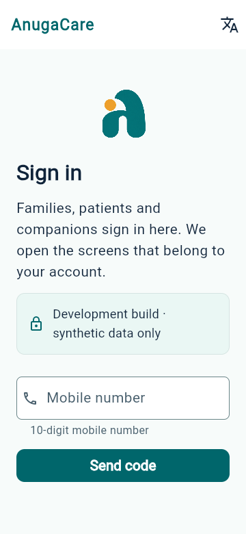
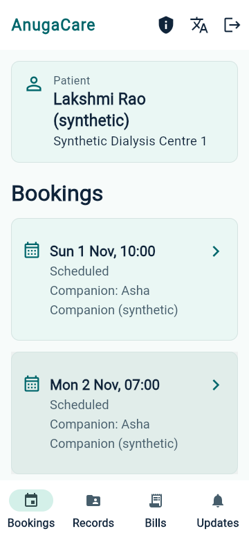
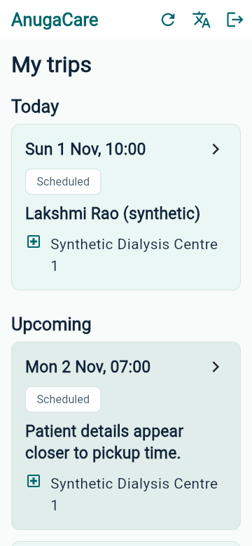
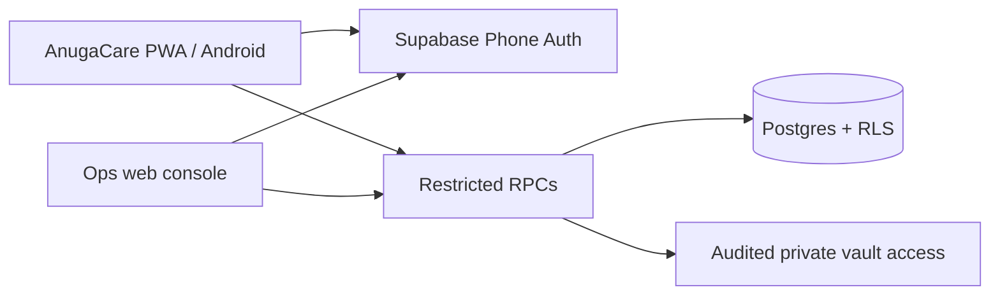

<div align="center">
  
  <h1>AnugaCare</h1>
  <p><strong>Someone beside you, every visit.</strong></p>
  <p>Scheduled dialysis-visit companionship, family updates and a private health-record vault.</p>

  <a href="https://github.com/iamnawin/anuga/actions/workflows/db-tests.yml"></a>
  <br /><br />
  <a href="https://anuga.vercel.app/app/">Synthetic test app</a> &nbsp;?&nbsp;
  <a href="docs/SETUP.md">Setup</a> &nbsp;?&nbsp;
  <a href="docs/ARCHITECTURE.md">Architecture</a> &nbsp;?&nbsp;
  <a href="docs/TASKS.md">Roadmap</a>
</div>

Published update (2026-11-14): completed Companion, Welcome hero, Family visit,
legal draft and error-handling changes are merged through PR #44 and live on the
synthetic test app. Phone/OTP, consent and Home are retained. Terms/Privacy remain
read-only drafts. Release CI passed all seven jobs; live bundles and routes verified.
See [handoff](docs/HANDOFF.md) and [publication evidence](docs/evidence/ui-publication-2026-11-14/README.md).


<br />

> **Synthetic staging only.** People, visits and bills in the test environment are invented.
> Production launch, real patient data and paid-provider activation remain gated.

## Care built around a recurring visit

AnugaCare is being built for families and patients who need dependable support
for scheduled hemodialysis visits, starting in Hyderabad. A primary companion,
with backup coverage, supports the journey from pickup to the centre and home.
The service is non-clinical; it does not provide emergency dispatch or sell medicines.

One shared sign-in opens the family or companion view according to the account's
database role. Operations staff use a separate web console.

| Family & patient | Companion | Operations |
| --- | --- | --- |
| Bookings, visit updates, permitted records and bills | Assigned trips, pickup-code verification and visit check-ins | Schedules, assignments, trip generation, exceptions and billing |
| Access follows the family's permissions | Only trip essentials; no vault, diagnoses or date of birth | Internal web console with database-enforced access |

## A look inside

<table>
  <tr>
    <th>One sign-in</th>
    <th>Family bookings</th>
    <th>Companion trips</th>
  </tr>
  <tr>
    <td></td>
    <td></td>
    <td></td>
  </tr>
</table>

These are release-web screenshots at a phone-sized desktop Chrome viewport,
using the hosted synthetic backend. They are not physical-device screenshots.
[English, Telugu and Hindi screenshots and verification ledger ?](docs/evidence/pwa-readiness-2026-11-01/README.md)

## PWA first. Android preserved.

The current development priority is the unified Flutter web/PWA while features
evolve. Existing Android projects and APK support remain intact. A web build
and browser tests do not require an Android SDK.

| Area | Current state |
| --- | --- |
| Shared sign-in | Phone OTP; family/companion home chosen by `profiles.role`; Ops directed to the web console |
| PWA readiness | Chrome installability checks, mobile layouts, browser Back, offline Refresh/reconnect and browser freeze/resume checked |
| Languages | English, Telugu and Hindi layouts reviewed; native-speaker wording approval pending |
| Device readiness | Phone installation, real keyboard/system Back and OS resume checks pending; no phone available for verification |
| Android | CI builds a staging APK with the existing public synthetic backend settings; native runtime remains unverified |
| Offline use | Recovery after reconnect checked; cold offline launch and offline patient-data storage are not promised |

The detailed PWA pass is recorded in [PR #19](https://github.com/iamnawin/anuga/pull/19).
Check the PR and [HANDOFF](docs/HANDOFF.md) for the latest source, deployment state,
checks and next steps. The hosted test app does not automatically include unmerged work.

## How it fits together



Supabase is the system of record. Access is enforced by database grants,
row-level security and restricted functions. The clients do not decide who may
read a patient's data. External notification and payment integrations remain
test adapters; paid providers have not been activated.

## Get started

Use Node.js 24+, pnpm and Flutter 3.47.6 / Dart 3.13.5.
Exact environment and synthetic-backend instructions are in [SETUP](docs/SETUP.md).

From the repository root:

```sh
pnpm install --frozen-lockfile
pnpm typecheck
pnpm db:test
```

For the unified PWA, follow the
[web build and local-server walkthrough](docs/SETUP.md#unified-anugacare-pwa-first-development-2026-11-01).
Only a public anon/publishable client key belongs in an app; never a service-role key.
No real patient data belongs in development or testing.

Run the complete local checks sequentially in Git Bash or a compatible shell:

```sh
scripts/check-all.sh
```

Real-Supabase and full-journey checks also run in GitHub Actions. Local widget
or browser checks do not count as physical-device verification.

## Repository map

| Path | Responsibility |
| --- | --- |
| [`apps/anugacare_app`](apps/anugacare_app/README.md) | Unified Flutter entry app; PWA and Android |
| [`apps/family_app`](apps/family_app/README.md) | Reused family views and standalone transition app |
| [`apps/companion_app`](apps/companion_app/README.md) | Reused companion views and standalone transition app |
| [`apps/ops_console`](apps/ops_console/README.md) | Next.js operations console |
| [`packages/shared_dart`](packages/shared_dart/README.md) | Shared APIs, models and trip-state rules |
| [`supabase`](supabase) | Migrations, restricted functions, synthetic seeds and database tests |
| [`docs`](docs) | Product requirements, decisions, setup, handoff and evidence |

## Read next

- [Product spec](docs/PRODUCT_SPEC.md) ? users, service scope and permissions.
- [Architecture](docs/ARCHITECTURE.md) ? components, data flow and access boundaries.
- [UX & Accessibility Audit (`UX_AUDIT.md`)](docs/UX_AUDIT.md) ? permanent UX findings (`UX-01`–`UX-08`), product recommendations and open founder decisions.
- [UX Implementation Plan (`UX_IMPLEMENTATION_PLAN.md`)](docs/UX_IMPLEMENTATION_PLAN.md) ? phased UI modernization work packages and lifecycle status.
- [Tasks](docs/TASKS.md) ? milestones and acceptance criteria.
- [Handoff](docs/HANDOFF.md) ? current work, validation and exact next steps.
- [Contributor instructions](AGENTS.md) ? repository rules and permanent multi-agent handoff policy.

Remaining limits carry forward: no new signed-in `/ops/` journey, hosted fixture
cleanup pending, and fixtures must be refreshed before future trip-grouping checks.
The **180-minute companion start window remains provisional**. Production launch,
real data and paid providers remain gated.

---

Built by **ZeroOrigins AI** ? Internal codename: `companion` ? Brand: **AnugaCare**
