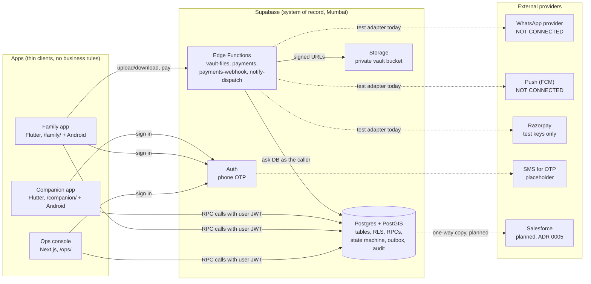
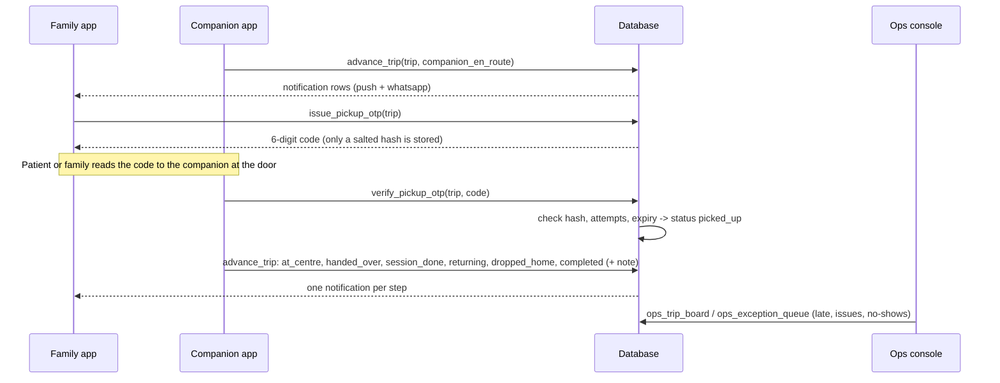
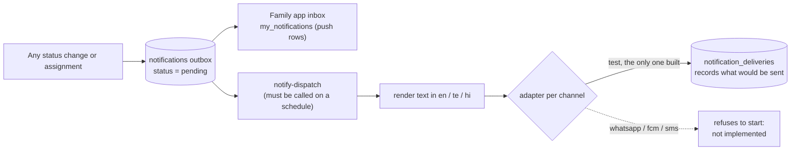

# Architecture: what is built and how it connects

Written 2026-10-20 from the code on `main` (64c4603), not from the plans. Where the code and
the spec differ, the code is described here and the gap is listed under "Not built yet".

## 1. One-minute picture



**Rule that explains everything else:** the database is the security boundary. Every "who may
see or do what" check lives in Postgres (grants, row-level security and `security definer`
functions). The apps only call functions and draw screens. A bug in an app can't leak data
that the database refuses to return.

## 2. Supabase or Salesforce?

**Supabase stays.** It is the live database the three apps read and write, the login system
and the file store. Salesforce (ADR 0005) will hold a one-way copy for ops CRM and reporting.

Think of Supabase as the kitchen and Salesforce as the manager's dashboard on the wall. The
dashboard shows what's happening; the cooking never moves there.

## 3. Components and where they live

| Component | Folder | What it does | Talks to |
| --- | --- | --- | --- |
| Database schema and rules | `supabase/migrations/` (9 files) | Tables, access rules, all business actions as SQL functions | Everything below calls into it |
| Seed data | `supabase/seed/seed.sql` | Synthetic patients, families, companions, a schedule and 14 days of trips | Database |
| `vault-files` function | `supabase/functions/vault-files/` | Upload and download health records via short-lived signed URLs | Database (as caller), Storage (service role) |
| `payments` function | `supabase/functions/payments/` + `_shared/payments.ts` | Starts a bill payment; in test mode, completes it | Database, payment adapter |
| `payments-webhook` function | `supabase/functions/payments-webhook/` | Receives the provider's signed "payment captured" call | Database (service role) |
| `notify-dispatch` function | `supabase/functions/notify-dispatch/` | Drains the notifications outbox and sends each message | Database (service role), message adapters |
| Shared Dart package | `packages/shared_dart/` | Models, `CompanionApi` / `FamilyApi` / `OpsApi`, trip state machine | Used by both Flutter apps |
| Ops console | `apps/ops_console/` | Trips board, schedules and assignment, exceptions, billing | Database RPCs (`src/lib/api.ts`) |
| Family app | `apps/family_app/` | Patients, visit status and timeline, pickup code, inbox, records, consents, bills | Database RPCs, `vault-files`, `payments` |
| Companion app | `apps/companion_app/` | My trips, step-by-step trip actions, pickup code entry | Database RPCs |
| Web build and hosting | `scripts/build-staging.sh`, `vercel.json`, `.github/workflows/deploy-anuga-test.yml` | Builds all three as one static site at anuga.vercel.app | Vercel |
| Tests | `supabase/tests/`, each app's `test/`, `scripts/e2e-journey.sh` | DB access tests, app tests, full journey | CI (`.github/workflows/db-tests.yml`) |

## 4. The database, layer by layer (parent to child)

Each migration builds on the ones before it.

| Migration | Adds | Key items |
| --- | --- | --- |
| `0100` core schema | The tables | `profiles`, `clusters`, `centres`, `patients`, `patient_access`, `consents`, `companions`, `packages`, `schedules`, `trips`, `trip_otps`, `trip_events`, `trip_transitions`, `notifications`, `audit_log`, `app_settings` |
| `0200` access rules | Who may touch what | Revokes Supabase's default grants; RLS policies; helpers `is_ops`, `access_level_for`, `can_view_patient`, `can_edit_patient`, `can_view_trip`; audit triggers; `handle_new_user` (creates a `profiles` row for each new login) |
| `0300` trip workflow | The business actions | `create_patient`, `ops_assign_schedule_companions`, `ops_assign_trip_companion`, `ops_generate_trips`, `issue_pickup_otp`, `verify_pickup_otp`, `advance_trip`, `family_trip_board`, `companion_my_trips`; internal `apply_transition`, `notify_patient_family`, `notify_user` |
| `0400` vault | Health records | `vault_documents`, `vitals`, `medicines` (no direct SELECT for anyone); `vault_list_*` functions that check access and write an audit row |
| `0500` ops reads | Ops screens | `ops_trip_board`, `ops_schedule_board`, `ops_exception_queue`, `ops_companion_options` |
| `0600` family reads | Family screens | `family_my_patients`, `family_trip_timeline`, `my_notifications` |
| `0700` dispatch | Sending messages | `dispatch_claim_notifications`, `dispatch_mark_sent`, `dispatch_mark_failed` (service role only); `notification_deliveries` (what the test adapter "sent") |
| `0800` vault storage | Files and consents | Private bucket; `vault_create_document`, `vault_upload_target`, `vault_mark_uploaded`, `vault_document_download`; `family_consents`, `set_consent` |
| `0900` payments | Billing | `invoices`, `invoice_lines`, `payments`; `ops_record_trip_fare`, `ops_generate_invoice`, `ops_issue_invoice`, `ops_invoices`, `family_invoices`, `family_invoice_lines`, `payment_start`, `payment_set_order`, `payment_captured` |

**Roles** come from data, not from the login:

- **Ops:** `profiles.role = 'ops_admin'`.
- **Family:** has a `patient_access` row for the patient (owner, editor, viewer or patient).
- **Companion:** has a `companions` row and is assigned on the trip.

All three sign in the same way, with phone OTP.

**Business values** (pickup-code expiry, attempt limits, visibility window, retry backoff,
prices) live in `app_settings` and `packages`, not in code.

## 5. Who calls what

| Caller | Database functions it calls | Edge functions |
| --- | --- | --- |
| Ops console | `ops_trip_board`, `ops_schedule_board`, `ops_exception_queue`, `ops_companion_options`, `ops_assign_schedule_companions`, `ops_assign_trip_companion`, `advance_trip`, `ops_record_trip_fare`, `ops_generate_invoice`, `ops_issue_invoice`, `ops_invoices` | none |
| Family app | `family_my_patients`, `family_trip_board`, `family_trip_timeline`, `issue_pickup_otp`, `advance_trip` (cancel), `my_notifications`, `vault_list_documents`, `family_consents`, `set_consent`, `family_invoices`, `family_invoice_lines` | `vault-files`, `payments` |
| Companion app | `companion_my_trips`, `advance_trip`, `verify_pickup_otp` | none |
| `vault-files` | `vault_create_document`, `vault_upload_target`, `vault_mark_uploaded`, `vault_document_download` (as the user), then signs storage URLs (service role) | — |
| `payments` | `payment_start` (as the user), `payment_set_order` (service role) | — |
| `payments-webhook` | `payment_captured` (service role, after checking the signature) | — |
| `notify-dispatch` | `dispatch_claim_notifications`, `dispatch_mark_sent`, `dispatch_mark_failed` (service role) | — |

Apps hold only the public (anon/publishable) key plus the user's login token. No app holds the
service-role key; only edge functions do.

## 6. The flows, step by step

### 6.1 Sign in (all three apps)

1. The user types a phone number. The app calls `signInWithOtp(phone, shouldCreateUser: false)`,
   so unknown numbers are refused ("Signups not allowed for otp").
2. Supabase Auth sends an SMS. Today it sends nothing: test numbers with a fixed code are set
   in the dashboard, and the SMS provider has placeholder values.
3. The user enters the code. The app calls `verifyOTP` and receives a login token (JWT).
4. Every later call carries that JWT. The database reads `auth.uid()` from it and applies the rules.

### 6.2 From schedule to trips

1. A patient has a weekly `schedules` row: days, pickup time, session length, package.
2. `ops_generate_trips(schedule, from, days)` creates one `trips` row per visit.
3. Ops assigns a primary and a backup companion with `ops_assign_schedule_companions`. That
   notifies the family (`companion_assigned`) and both companions (`schedule_assigned`).
4. Ops can swap the companion on one trip with `ops_assign_trip_companion`, which notifies the
   family (`companion_changed`) and the new companion (`trip_assigned`).

### 6.3 A visit (the core journey)



Inside every status change, `advance_trip` does the following:

1. Works out who is calling: the companion on the trip, ops, or a family editor.
2. Checks the move is allowed in `trip_transitions`. That table is the state machine as data.
3. Calls `apply_transition`, which:
   - updates the trip
   - appends a `trip_events` row (the timeline)
   - calls `notify_patient_family`, which writes one `notifications` row per family member per
     channel (push and WhatsApp)

`picked_up` can only be reached through `verify_pickup_otp`. The apps build their buttons from
the same rules (`TripStateMachine` in `shared_dart`). A contract file
(`trip_contract.json`) keeps the SQL and Dart sides from drifting apart.

### 6.4 Notifications (including WhatsApp)



- **What's built:**
  - The outbox.
  - Messages in three languages, with no health details in them.
  - The dispatcher, which handles leases, retries with backoff and permanent failures.
  - A `test` adapter that writes to `notification_deliveries` instead of sending.
- **What's not built:**
  - A real WhatsApp, push or SMS sender. Choosing one stops the function with a clear error
    (`adapters.ts`).
  - A scheduler that calls `notify-dispatch` every minute.
  - Deployment of `notify-dispatch` to the hosted project.
- **What works today:** the family app's inbox reads the `push` rows straight from the outbox,
  so in-app updates work without the dispatcher.

**To make WhatsApp real:**

1. Pick a provider: Meta Cloud API directly, or a business solution provider such as Gupshup,
   Interakt or AiSensy. This is an open decision in spec section 10.
2. Get message templates approved by Meta: status update, companion change, bill ready.
3. Write a `whatsapp` adapter in `adapters.ts` that implements `send()`.
4. Store its keys as Supabase secrets.
5. Set `NOTIFY_WHATSAPP_ADAPTER=whatsapp` and `NOTIFY_LIVE_PROVIDERS_AUTHORIZED=yes`. Both need
   founder authorization.
6. Schedule the function, using `pg_cron` + `pg_net`.

### 6.5 Health records (vault)

1. The family app calls `vault-files` with `upload`. The function asks the database, as the
   user, whether they may upload. Writes need the owner's `vault` consent.
2. The database creates the document row and a server-chosen file path.
3. The function returns a signed upload URL. The app uploads the file straight to Storage, then
   calls `confirm`.
4. To download, the app sends `download`. The database checks access and writes an audit row,
   then the function returns a short-lived signed URL.
5. Companions can never reach any of this, and ops need the owner's `ops_vault_access` consent.

### 6.6 Billing and payment

1. When a visit completes, ops records its fare with `ops_record_trip_fare`.
2. Ops builds a monthly bill (`ops_generate_invoice`), then issues it (`ops_issue_invoice`).
   Only `completed` visits are billed (`app_settings.billable_trip_statuses`).
3. The family owner taps Pay. The family app calls `payments` with `start`, which calls
   `payment_start` and asks the adapter for an order.
4. **Test mode:** the app calls `complete-test`. The function signs a fake webhook body and runs
   the same `payment_captured` path a real provider would trigger.
5. **Razorpay:**
   - The adapter can already create orders with test keys (`rzp_test_...`).
   - Live keys are refused without `PAYMENTS_LIVE_AUTHORIZED=yes`.
   - The family app has no Razorpay checkout screen yet; it shows a "not part of this build"
     message.

## 7. Integrations: status at a glance

| Integration | Status | What's needed for real use |
| --- | --- | --- |
| Phone OTP (Supabase Auth) | Works with test numbers only | An SMS provider (Twilio, MSG91 or another), a DLT-registered sender ID for India, and the paid provider (M10) |
| WhatsApp | Outbox and test adapter only | Provider, approved templates, adapter code, schedule (see 6.4) |
| Push (FCM) | Outbox and test adapter only | Firebase project, a device-token table, FCM adapter |
| SMS notifications | Test adapter only | Same provider as OTP, plus an adapter |
| Razorpay | Order API with test keys; no app checkout | Checkout SDK in the family app, webhook URL set in Razorpay, live keys (M10) |
| Google Maps | **Not built.** Locations are stored as PostGIS points | Geocoding at patient creation, ETA; behind a provider interface |
| Sentry | Not built | Add the SDK to the three apps (no patient data in events) |
| Salesforce | Planned (ADR 0005, M9a) | Outbox, `crm-sync` function, Developer Edition org |

## 8. How to test each part

**Hosted (synthetic), no install:** open https://anuga.vercel.app and pick Ops, Family or
Companion in separate tabs.

- **Accounts:**
  - ops: `9000000001`
  - family owner: `9000000101`
  - companion Ravi: `9000000202`
  - The code is the one set in the Supabase dashboard.
- **Get a visit into the companion's time window:** run the synthetic visit SQL in
  `docs/LOCAL_TESTING.md`.
- **Walk the visit:** assign Ravi in Ops, generate the pickup code in Family, then walk every
  step in Companion and watch Family's timeline and inbox update.

**Automated (no setup beyond Node):**

```sh
pnpm install --frozen-lockfile
pnpm db:test              # every access rule, the state machine, OTP, vault, dispatch, payments (PGlite)
scripts/check-all.sh      # all fast checks across the repo
```

**Full journey on a real local Supabase (needs Docker):** `scripts/e2e-journey.sh`. CI runs it on
every push, in the `supabase-local` job.

**WhatsApp and notifications, today:** nothing is sent, so you test what would be sent.

1. Do any status change, for example a companion taps "On the way".
2. In the Supabase SQL editor:

   ```sql
   select id, recipient_id, channel, template, status, payload
   from public.notifications order by id desc limit 10;
   ```

   You should see one `push` and one `whatsapp` row per family member.
3. On a local stack, run the dispatcher with the test adapter:

   ```sh
   curl -X POST http://127.0.0.1:54321/functions/v1/notify-dispatch \
     -H "Authorization: Bearer <local SERVICE_ROLE_KEY>"
   ```

   Then check the rendered text, in the recipient's language:

   ```sql
   select channel, language, title, body from public.notification_deliveries order by id desc;
   ```

   The rows in `notifications` turn `sent`.
4. Automated: `node --test --test-isolation=none supabase/tests/dispatcher_unit.test.ts supabase/tests/dispatch.test.ts`.

**Payments, today:** in Family → Bills, pay an issued bill. The test adapter completes it, and
Ops → Billing shows it as paid.

## 9. Not built yet: what matters for 10 real customers

1. **Onboarding screens.** There is no UI to add a patient, a family member, a companion or a
   weekly schedule. Today that's SQL: `create_patient` exists but no screen calls it, and
   schedules come only from the seed.
2. **Automatic trip generation.** `ops_generate_trips` exists, but nothing calls it on a
   schedule, and the ops console has no button for it.
3. **A scheduler for `notify-dispatch`**, plus deploying it to the hosted project.
4. **Real senders:** WhatsApp, SMS OTP and push (section 7).
5. **Razorpay checkout** in the family app.
6. **Maps:** geocoding addresses and ETAs.
7. **Consent and privacy for real data:**
   - a DPDP notice
   - a deletion job for withdrawn consent
   - a breach runbook
8. **The Salesforce copy** (M9a).

Items 1–3 are needed even with only 10 customers. Items 4–8 sit behind the M10 founder gate,
except building against test or sandbox accounts.
