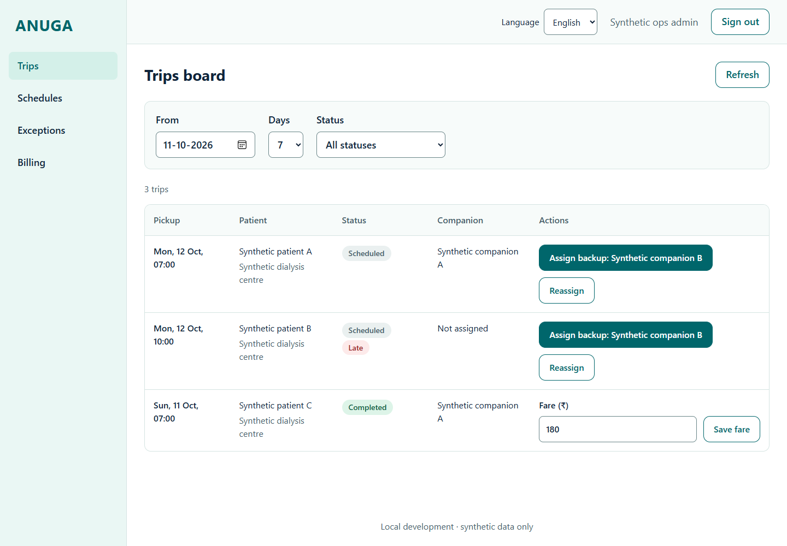
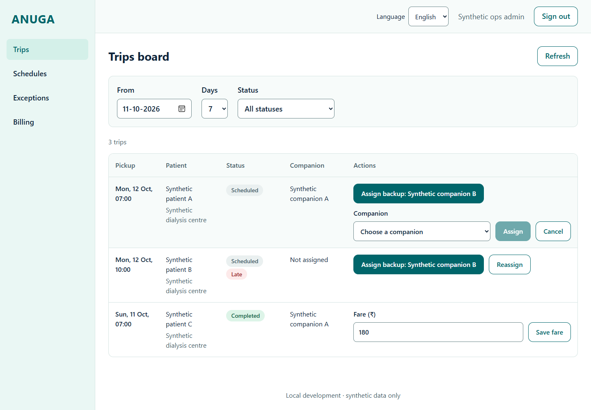
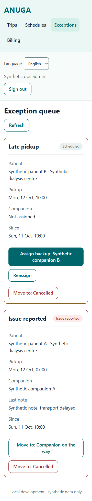

# S3 ops UI evidence

2026-10-11, branch `ui/s3-ops-console`. These are captures of the real local Next app with synthetic auth/profile/RPC responses intercepted in the browser harness. They verify presentation; they do not prove real sign-in, database permissions or the Supabase journey. No production data or keys.

| Changed screen | Concept reference | Intentional difference | Capture |
| --- | --- | --- | --- |
| Login and OTP | board 1 panels 02-03 | Existing ops role gate and phone form, no welcome/signup | login-1440.png, otp-1440.png |
| Shell and trips | board 11 panel 41 | Four existing destinations, real trip-state labels/filters; no overview metrics | trips-desktop.png |
| Reassignment | board 11 panel 42 | Existing inline select, eligibility errors retained; no new standalone screen | assignment-desktop.png |
| Schedules and primary/backup | board 11 panels 43/42 | Existing schedule cards and inline assignment; no calendar editor | schedules-desktop.png, schedule-assignment-desktop.png |
| Exceptions | board 11 panel 41 vocabulary | Unmatched concept; actual late/issue actions retained | exceptions-desktop.png |
| Billing and fare | corrected board 15 panel 46 | Existing generate/issue/fare workflow; no exports, payouts or sample pricing | billing-desktop.png, trips-desktop.png |

All concept filenames and full mapping are in `docs/design/tokens.md`. Accessibility differences: 48px controls, larger text, visible keyboard focus, narrow tables scroll in labelled focusable regions, automatic dark theme and flat teal instead of mottled gradients.

23 captures: four boards at 1440, 360 and 430px; two desktop assignment forms; English phone/OTP at 1440/360; Telugu/Hindi trips at 360; dark trips; Telugu schedule at 200% text and focused login. `capture-results.json` records zero page errors, zero page-wide overflow and zero measured controls with height below 48 for all 23. Parent visually inspected representative desktop, narrow, locale and login captures.

Validation: Git Bash `scripts/check-all.sh` native exit 0. Install/root typecheck pass; PGlite 140 pass, 8 real-Supabase skips; ops lint/typecheck/build pass, 52 tests; shared Dart format/analyze pass, 27 tests; companion format/analyze pass, 39 pass/3 environment skips; family format/analyze pass, 35 pass/6 environment skips. Separate final ops `pnpm lint`, `pnpm typecheck`, `pnpm test` pass (52). Diff whitespace passes. No tests modified.

Not run: real Supabase journey/RLS suite (Docker unavailable), hosted staging, native-language review. In-app browser bootstrap failed before connection (kernel ESM error); repository Playwright via installed Edge provided local evidence.

## Founder testing

From this worktree root run `pnpm install --frozen-lockfile`. Set up Supabase local using `docs/SETUP.md`, configure the ops `.env.local` with local URL and publishable/anon key, then from `apps/ops_console` run `pnpm dev`. Open http://localhost:3000/login and sign in with synthetic ops number 9000000001, local code 123456. Test trips, assign backup, rejected ineligible assignment, schedules, exceptions, fare and draft invoice issue. Switch en/te/hi, resize to 360/430 and desktop, enable dark mode and 200% browser text. Never use a service-role key.

The capture-only dev server used `pnpm exec next dev --port 3103 --hostname 127.0.0.1`, http://127.0.0.1:3103, synthetic placeholder env and ignored `artifacts/s3/capture.mjs`. Opening that URL directly does not provide the intercepted synthetic session. For an authenticated founder test use the local backend above or staging after PR #2 founder setup. UI PR does not deploy or include staging changes.

