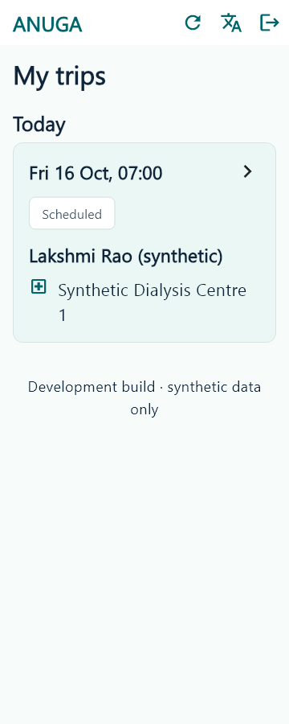
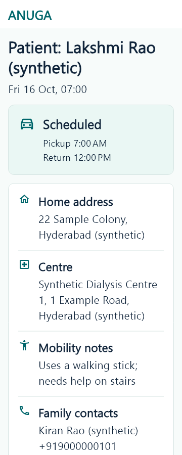
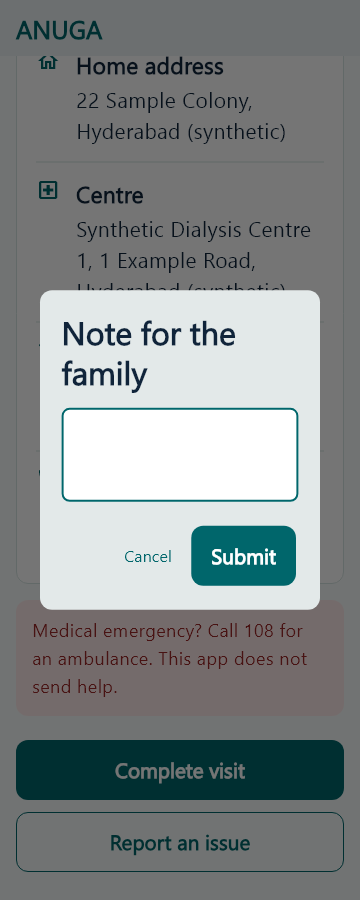
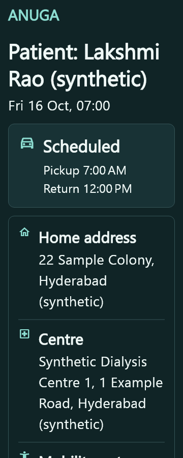

# S4 companion UI evidence

2026-10-11, `ui/s4-companion`, main plus S2 PR #4. Seven authorized product files: theme/app widget, login/trips/trip screens and en/te/hi ARB brand titles. ANUGA wordmark, teal controls, navy/mint panels, patient/time/route hierarchy, clear status glyphs and scrollable confirmation dialogs. No action, adapter, auth, RPC, state transition or restricted projection change.

| Changed screen | Reference | Intentional difference | Example capture |
| --- | --- | --- | --- |
| Login / verify | board 1 panels 02-03 | Existing companion role gate, no welcome/signup/onboarding | 360-en-1.15-light-login.png, login-code.png |
| Today / upcoming list | board 9 panel 31 | Actual API list and window rules; no greetings, earnings/profile tabs or counts | 360-en-1.15-light-trips.png |
| Essentials / hidden details | board 9 panel 32 | Real restricted fields only, no photos/maps/directions/calling | 360-en-1.15-light-scheduled.png, details-hidden.png |
| En route / pickup OTP / centre / handover | board 8 panels 33-36 | Existing state-machine actions and OTP field, no new arrival state/checklist/ETA | companion_en_route-actions.png, picked_up-dialog.png, at_centre-dialog.png |
| Session / return / home / note / complete | board 10 panels 37-40 | Existing required note and states, no earnings, fare or receipt upload | returning-actions.png, dropped_home-dialog.png, completed-actions.png |
| Issue / no-show / cancelled | board 8 panel 35; board 10 panel 37 vocabulary | Unmatched dialogs; descriptions/confirmation and emergency notice retained | scheduled-dialog.png, issue_reported.png, no_show.png, cancelled.png |

All filenames in the English base set carry `360-en-1.15-light-` before the short names above. Every one of the 12 statuses has a top and scrolled actions capture. Four dialogs, login/verify, list, empty and hidden-detail states are included. Additional curated 430-width, Telugu/Hindi and dark captures show the accessibility extensions. Exact concept filenames and panel mapping: `docs/design/tokens.md`.

These are real Flutter widgets rendered by flutter test with the existing synthetic fake backend. They are not live Android/device screenshots or real sign-in/DB/RLS verification. Golden rendering's Ahem font was replaced only in the ignored capture harness with Windows Nirmala and SDK MaterialIcons, including component fonts. No product font, dependency or test was changed for screenshots. The full local matrix produced165 PNGs across five configurations (360/430x900, en1.15, te/hi1.5, dark en1.5), five capture tests passed without layout exceptions; 38 representative images are committed here. Parent visually reviewed light login/list/trip/note and dark trip samples; terminal statuses use distinct meaningful glyphs.

Accessibility differences: at least48 logical targets,56-high primary actions, minimum1.15 text with larger settings honored, wrap/scroll instead of clipping, flat teal, visible outlines and automatic dark mode. Exact Unicode localized titles Anuga / అనుగా / अनुगा are preserved. No clinical/private data to companions.

Validation: final Git Bash scripts/check-all.sh exit0, install/root typecheck and all lint/typecheck/build/format/analyze pass. PGlite140pass/8 real-Supabase skips; ops52; shared Dart27; companion39pass/3 environment skips; family35pass/6 environment skips. Separate companion flutter analyze --fatal-infos no issues, flutter test39/3. Capture matrix5pass. git diff --check clean. Full log artifacts/s4/check-all.log; app logs analyze.log/flutter-test.log; captures screenshots.log. Existing tests unchanged.

Not run: real-Supabase journey (Docker unavailable), live device/emulator or hosted staging, native-language review. In-app browser tooling failed bootstrap; widget evidence does not depend on it.

## Founder testing

From apps/companion_app run `flutter pub get`, then `flutter analyze --fatal-infos` and `flutter test`. For a connected device run `flutter run -d <device-id> --dart-define=SUPABASE_URL=<local-or-approved-staging-url> --dart-define=SUPABASE_PUBLISHABLE_KEY=<anon-or-publishable-key>`. Android emulator uses http://10.0.2.2:54321 for Supabase local; see docs/SETUP.md and the app README for local setup. Never use a service-role key. Sign in as a synthetic companion, check assigned today/upcoming trips, hidden-details window, wrong/right pickup code, handover and required completion note, issue/no-show confirmation, en/te/hi, larger text and dark mode. This device flow was not run here because no device/emulator was available.

Exact capture command from apps/companion_app was `flutter test --update-goldens artifacts/ui_test.dart *> ../../artifacts/s4/screenshots.log`; temporary harness originally lived at apps/companion_app/artifacts/ui_test.dart. The temporary source is retained as artifacts/s4/ui_test.dart.txt; only the actual implementation and curated evidence are committed. Screenshots can be reviewed without credentials. Hosted testing still requires PR #2 plus founder dashboard steps; no deploy in this UI branch.

