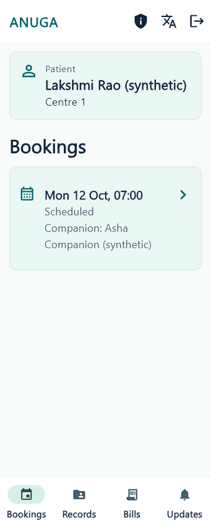
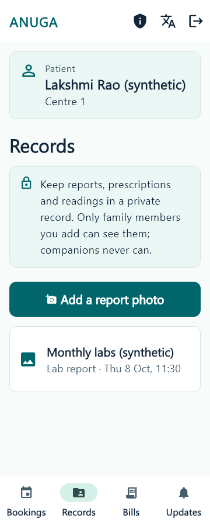
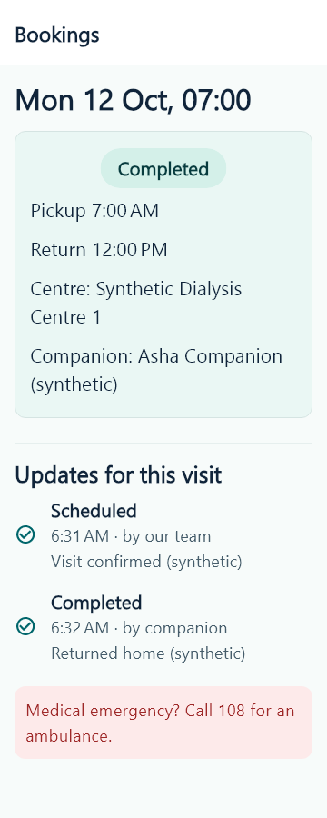
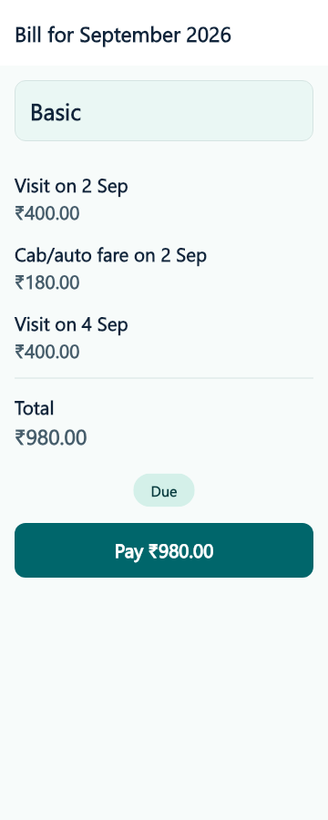

# S5 family and patient UI evidence

2026-10-11, `ui/s5-family`, main plus S2 PR #4. Fourteen authorized product files: theme, nine existing screens, one reused panel/heading widget and three ARB brand titles. Teal ANUGA, navy/mint hierarchy, visible patient context, visit timeline, private-record/consent panels and clear bills. Existing callbacks, keys, API calls, role gates, photo/upload/payment behavior and navigation retained.

| Changed screen | Concept reference | Intentional difference | Capture |
| --- | --- | --- | --- |
| Sign-in / verification | board 1 panels 02-03 | Existing family role sign-in, no signup/onboarding | login.png, verify.png |
| Home / patient picker / bookings | board 4 panels 13-14; board 7 panel 25 | Existing four destinations and patient-role experience; no new simplified mode, greeting identity, calendar/routine editor | home.png |
| Visit / OTP / timeline | board 4 panels 15-16; board 7 panel 26 | Existing authorized OTP and events, no location/ETA, calling/reschedule or fake milestones | visit.png, pickup-code.png |
| Completed visit | board 5 panel 17 | Actual events/notes, no receipt/download or charge summary capability | completed.png, completed-timeline.png |
| Records / photo source / metadata | board 5 panels 18-19 | Existing photo-only upload; no PDF, folders, access history or new fields | records.png, photo-source.png, photo-details.png |
| Image viewer and error | board 5 panel 20 | Existing signed-image viewer/error; synthetic report image contains no medical values | record-viewer-image.png, record-viewer.png |
| Consent | board 1 panel 04; corrected board 14 panels 23-24 | Existing purposes and owner rules, no family invites/access editor | consent.png |
| Bills / detail / test-payment result | corrected board 13 panel 11; board 14 panel 24; board 15 panel 46 | Existing monthly invoice and owner-only test checkout, no UPI/card or plan selection | home-bills.png, bill-detail.png, test-payment.png |
| Updates inbox | board 4 panel 16 vocabulary | Unmatched standalone screen, actual notifications retained | home-inbox.png |

Short filenames above carry `360-en-1.15-light-` prefix. Source filenames and panel map: docs/design/tokens.md. No medicines, requests, invites, new patient mode or clinical behavior added.

25 curated captures include all existing screens, dialogs, successful/error image viewer, Telugu/Hindi home, dark home, 360x640 at3x text with long names/centre and two patients, scrolled picker, switched patient and inbox. The complete ignored matrix produced114 PNGs; seven scenarios passed. Missed taps are fatal. Extreme-text test opens the real dropdown, selects the second synthetic patient, scrolls navigation and reaches Updates. Parent reviewed representative login/home/Telugu/OTP/consent/photo/bill/timeline/image and extreme-text captures.

These are actual Flutter widget renders using existing synthetic fake APIs, not live device or backend tests. A synthetic local photo fixture supplies the viewer image. Golden Ahem fonts were replaced only in the ignored harness using Windows Nirmala/SDK MaterialIcons and explicit component fonts for readable evidence; no product font/dependency changes.

Accessibility adjustments: targets48+, primary56, uncapped user text scaling with minimum1.15, visible control boundaries, scrollable dialogs. Patient header/picker use a bounded scrollable area so tab content remains reachable. Bottom destinations scroll horizontally only when translated/scaled labels need more width; Material's label-scale cap is compensated so large text remains large. Dark theme and flat teal are extensions of the light concept.

Validation of final tree: Git Bash scripts/check-all.sh exit0; frozen install/root typecheck, all lint/typecheck/build/format/analyze pass. PGlite140pass/8 real-Supabase skips; ops52; shared Dart27; companion39pass/3 environment skips; family35pass/6 environment skips. Separate family flutter analyze --fatal-infos no issues and flutter test35/6. Seven visual scenarios pass without missed-tap warnings. git diff --check clean. No tests changed. Logs artifacts/s5-check-all.log,s5-analyze.log,s5-tests.log,s5-visual.log.

Not run: real-Supabase journey/permissions (Docker absent), device/emulator, hosted staging, native-language review. In-app browser tooling could not bootstrap; widget evidence is independent of it. Independent final source review confirmed callback/role/API behavior and large-text header fixes.

## Founder testing

From apps/family_app run `flutter pub get`, `flutter analyze --fatal-infos`, `flutter test`. For a connected device run `flutter run -d <device-id> --dart-define=SUPABASE_URL=http://10.0.2.2:54321 --dart-define=SUPABASE_PUBLISHABLE_KEY=<local-public-key>` with Supabase local configured per docs/SETUP.md. Use the approved staging URL/public key for staging after its founder setup; never a service-role key. No connected device run was available here.

Test synthetic owner/editor/viewer/patient accounts: bookings/patient picker, authorized pickup code and viewer denial, cancellation confirmation, timeline, private photo upload/viewer, owner consent withdrawal, issued bills and owner-only test payment, inbox. Switch en/te/hi and dark mode, larger text and narrow screens. Existing patient-role access is retained, not replaced with a new app mode.

Exact widget evidence command from apps/family_app: `flutter test ../../artifacts/s5_visual_test.dart`. Temporary harness and fixtures remain under ignored artifacts; curated PNGs and product code are committed. Device/emulator/Supabase local need setup before connected testing. Hosted staging is separate PR #2; no deployment or merge here.

