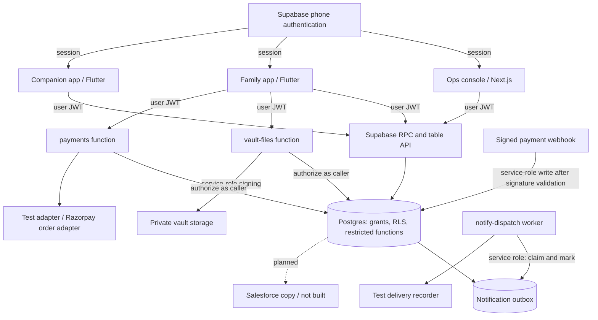
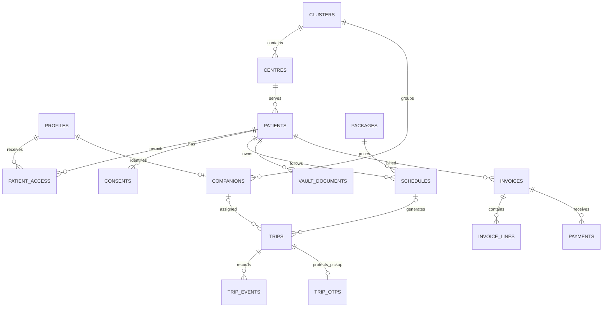

# Anuga — consolidated reverse-engineering document

**Prepared:** 22 October 2026 · **Target:** `srikar-priya09/anuga` · **Source commit:** `de28006e6518699a62a956c695a1d6a9eb8162e8`.

This is the single consolidated edition of the earlier `ANUGA_FINDINGS.md`. It retains that review's findings, adds methods from the requested GitHub skill repositories, expands the system and data maps, and supplies a reproducible evidence and remediation ledger. No product fixes are included.

## Executive decision

Anuga implements a credible synthetic visit journey, with substantial database authorization and tests. It is suitable for demonstrations and continued pilot engineering. It is not yet ready to independently run a real-customer service: onboarding, recurring operations, communication delivery, payment checkout, and several database workflow controls remain incomplete.

The recommended direction is to extend the existing architecture. Fix operational and privacy controls first, complete daily service workflows next, then connect external services and Salesforce. A new reverse-engineering tool does not change this conclusion; it improves how the conclusion is traced to evidence.

## How the requested GitHub repositories were used

The user supplied names rather than repository URLs. The following public projects were identified as matches. REA is a clear name match; the other two are relevant interpretations of “reverse engineering GitHub repository,” not a claim that either was the exact project the user had heard about.

| Repository and version inspected | Relevant skill/resource | Application to Anuga |
|---|---|---|
| [morluto/rea](https://github.com/morluto/rea/tree/4043e71f6cb9c708b07f3f27e15dfc42663e73f3) | [reverse-engineer-anything/SKILL.md](https://github.com/morluto/rea/blob/4043e71f6cb9c708b07f3f27e15dfc42663e73f3/.agents/skills/reverse-engineer-anything/SKILL.md), evidence-workflows reference | Follow evidence through feature paths; distinguish observations, inferences and unknowns. Its routing rule explicitly says “Skip REA for ordinary source-repository architecture analysis.” Anuga has complete source, so no REA server or binary engine was run. |
| [juank115/reverse-engineerskill](https://github.com/juank115/reverse-engineerskill/tree/02a29545cc16599b5f181f082a9d96dbce82791f) | [reverse-engineering/SKILL.md](https://github.com/juank115/reverse-engineerskill/blob/02a29545cc16599b5f181f082a9d96dbce82791f/skills/reverse-engineering/SKILL.md), report template | Adapt intake, static analysis, behavior validation and reporting to an available-source application. Disassembly, malware indicators and malware classifications are inapplicable here. |
| [zhaoxuya520/reverse-skill](https://github.com/zhaoxuya520/reverse-skill/tree/cab634bd855fc287f6e420c1f36fd1a6b9245960) | [code-audit/SKILL.md](https://github.com/zhaoxuya520/reverse-skill/blob/cab634bd855fc287f6e420c1f36fd1a6b9245960/skills/code-audit/SKILL.md), [database-security/SKILL.md](https://github.com/zhaoxuya520/reverse-skill/blob/cab634bd855fc287f6e420c1f36fd1a6b9245960/skills/database-security/SKILL.md) and their checklists | Inventory inputs and trust boundaries; trace authorization to database effects; manually validate findings; specify reproducible checks and fixes. |

These resources were read as methods. They were not installed globally, and their scripts or tool-bootstrap instructions were not executed. The case-review skill was inspected for context but its package validator was not applied: this deliverable is one Markdown document, not that project's multi-file case format. REA-style evidence labels below are local report IDs, not output from the REA MCP server.

## Scope, evidence rules and limits

Authorized scope is the local Anuga source tree and disposable synthetic tests. The review does not access hosted patient records, change hosted services, send messages, take payments, inspect unrelated installed applications or capture network traffic.

- **Observed/local:** source directly inspected, or a behavior reproduced with the repository's PGlite/PostGIS harness. It does not establish hosted behavior.
- **Inferred:** a code path supports a risk, but an actual concurrent/provider/device scenario was not reproduced.
- **Documented:** intent or historical results stated in project notes; not independently current.
- **Unknown:** evidence requires unavailable tools, deployment access, configuration or business decisions.
- **High/medium:** engineering triage priorities for this product; not formal CVSS scores or legal conclusions.

The repository inventory contains 398 tracked files, 23 public application tables, nine migrations and 37 distinct public application functions declared in migrations. These counts exclude platform-managed Supabase schemas and are not a claim that every file was exhaustively audited. Source coverage focused on the three apps' business paths, shared contracts, migrations, Edge Functions, tests and delivery configuration.

The review used source search and manual tracing. Semgrep and CodeQL were not available, so no automated SAST or current dependency-vulnerability scan is claimed. Binary/APK decompilation, device instrumentation, provider transactions and a hosted security assessment were not performed.

## Investigation coverage

| Question | Status | Evidence basis |
|---|---|---|
| What does Anuga do and where does authority reside? | Answered for source | App adapters, SQL workflow and permission migrations |
| What are the core visit, vault, dispatch and billing paths? | Answered for implemented source paths | Feature traces and API inventory below |
| Are the previously reported control gaps reproducible? | Answered locally | Eight fresh synthetic observations E01–E08 |
| Are user-facing live updates implemented? | Answered for inspected source | No polling/subscription mechanism found in reviewed app paths; one-time timeline load |
| Do the existing automated checks pass? | Partially answered | Earlier same-checkout checks passed; native and real-platform runs unavailable |
| Does the deployed site match this commit and configuration? | Unresolved | No current deployment attestation or hosted configuration inspection |
| Are external providers, backups and incident operations production-ready? | Unresolved | Not established by repository contents |

---

## Assessment retained from the earlier review

Anuga has a working synthetic visit workflow and a substantial database security foundation. It is suitable for a controlled demonstration and further pilot engineering. It is not yet a complete service platform for real customers. The largest gaps are operational onboarding and automation, consent enforcement, companion eligibility throughout a visit, external communications, and production payment handling.

This review traced the three applications, shared Dart contracts, nine SQL migrations, Edge Functions, test harness, CI and deployment configuration, and project documents. Existing tests and additional in-memory database probes were run. This is a source review with targeted runtime checks, not an exhaustive penetration test, native device test, or verification of the hosted environment.

## 1. What the system actually is

The business is scheduled non-clinical accompaniment for dialysis visits. A family owns a patient profile, has a recurring weekly schedule, and uses a primary and backup companion. Ops assigns companions and resolves exceptions. The companion records progress through pickup, centre handover, session completion, return and completion. Family members can inspect bookings, a timeline, report images, consent settings and bills.

Architecture:

- `apps/ops_console`: Next.js/React, browser authentication and database RPC calls; schedules, trips, exceptions and billing screens.
- `apps/family_app`: Flutter, family/patient bookings, pickup code, timeline, inbox, report images, consent and test billing.
- `apps/companion_app`: Flutter, assigned visits, time-limited patient detail projection, OTP verification and journey actions.
- `packages/shared_dart`: shared models, API wrappers and trip transition contract. It is not the security boundary.
- `supabase/migrations`: 23 public tables across nine migrations; authorization, business workflow, auditing, notification queue, vault and billing.
- `supabase/functions`: notification dispatch, vault signed URLs, payment requests and payment webhooks.
- Supabase Postgres is the source of truth. Most business logic is in SQL functions; there is no separate general-purpose application API server.
- Salesforce is a documented future one-way copy, not an implemented integration.

The core path is: pre-provision accounts and patient/schedule → generate trips → ops assigns → family issues pickup OTP → companion advances visit → database appends events and notification rows → ops bills completed visits → family simulates payment.

Trip states are scheduled → companion_en_route → picked_up → at_centre → handed_over → session_done → returning → dropped_home → completed, with cancellation, no-show and issue branches. SQL and Dart agreement is tested through an exported contract.

## 2. What is well implemented

- Database permissions, row security and restricted functions provide real access control independently of the UI.
- Client metadata does not determine privileged roles; clients cannot update their own role.
- Companions cannot select patient rows or health vault tables directly.
- Vault reads use audited functions; ops vault reads require owner consent. Storage paths are server-generated and access uses signed URLs.
- Pickup codes are salted hashes, with expiry, attempt limits and one-time consumption. Wrong-code attempts persist instead of rolling back with an exception.
- Trip mutations take row locks and write events plus notifications transactionally.
- Notification infrastructure includes claim/retry/backoff behavior and localized templates. Outbound templates deliberately omit visit notes.
- Billing amounts use integer paise; payment webhook signatures and amount checks are implemented.
- The test suite includes negative authorization cases and a real-Supabase CI path. This is stronger than UI-only role checking.

These strengths do not eliminate the gaps below: an allowed transition can still be accepted under the wrong operational circumstances.

## 3. Confirmed defects and missing controls

### F01 · High: withdrawing visit consent does not stop visit processing

`set_consent` changes the consent record, but assignment, trip generation, companion detail visibility and trip progression do not consult the active trips consent.

Reproduction: withdrew the owner's trips consent; the assigned companion still received the patient's name with `details_visible=true` and successfully advanced the trip to `companion_en_route`.

Impact: the privacy switch records a preference without enforcing its expected operational effect. Define how withdrawal affects future visits and safe handling of an already active visit, then enforce that policy in SQL.

Sources: [20261008000800_vault_storage.sql:205](https://github.com/srikar-priya09/anuga/blob/de28006e6518699a62a956c695a1d6a9eb8162e8/supabase/migrations/20261008000800_vault_storage.sql#L205); [20261008000300_trip_workflow.sql:267](https://github.com/srikar-priya09/anuga/blob/de28006e6518699a62a956c695a1d6a9eb8162e8/supabase/migrations/20261008000300_trip_workflow.sql#L267), `:391`, `:467`.

### F02 · High: untrained companions are eligible, and suspension does not stop existing trip actions

Assignment checks active status, verification, cluster membership and radius, but ignores `training_completed`. After assignment, `advance_trip` checks the assigned user and transition, without rechecking active/verified status.

Reproductions: set Ravi's training flag false and successfully assigned him; subsequently marked him inactive and suspended and successfully started his existing trip.

Impact: verification/onboarding fields give a stronger impression of enforcement than the workflow provides. Recheck eligibility and establish an explicit exception process for safely transferring an active visit.

Sources: [20261008000300_trip_workflow.sql:79](https://github.com/srikar-priya09/anuga/blob/de28006e6518699a62a956c695a1d6a9eb8162e8/supabase/migrations/20261008000300_trip_workflow.sql#L79), `:391`; [20261008000500_ops_console.sql:142](https://github.com/srikar-priya09/anuga/blob/de28006e6518699a62a956c695a1d6a9eb8162e8/supabase/migrations/20261008000500_ops_console.sql#L142).

### F03 · High: overlapping companion bookings are accepted

There is no availability/conflict check or database exclusion constraint for the same companion across overlapping visits. The eligibility-options function does not even take a trip time.

Reproduction: created two visits with identical pickup and return times; ops assigned Ravi to both successfully.

Impact: dispatch can promise service the team cannot deliver. Model actual occupied intervals, travel buffers and whether a companion stays through a session; enforce conflicts transactionally.

Sources: [20261008000300_trip_workflow.sql:232](https://github.com/srikar-priya09/anuga/blob/de28006e6518699a62a956c695a1d6a9eb8162e8/supabase/migrations/20261008000300_trip_workflow.sql#L232); [20261008000500_ops_console.sql:142](https://github.com/srikar-priya09/anuga/blob/de28006e6518699a62a956c695a1d6a9eb8162e8/supabase/migrations/20261008000500_ops_console.sql#L142); core trips schema.

### F04 · High: the restricted patient-detail window is not a complete trip-data boundary

`companion_my_trips` hides patient details outside its configured window. However, authenticated companions also have direct SELECT access to their `trips` and `trip_events` rows. Those rows include free-text notes and event locations, without the same window.

Reproduction: added a synthetic sensitive event note on a visit 30 days away; the assigned companion read it directly from `trip_events`.

Impact: notes and locations can remain available outside the intended window. This does not expose vault tables, but it undermines the broader time-limited detail promise. Use restricted read functions or column grants with consistent time and field policies.

Source: [20261008000200_access_rls.sql:128](https://github.com/srikar-priya09/anuga/blob/de28006e6518699a62a956c695a1d6a9eb8162e8/supabase/migrations/20261008000200_access_rls.sql#L128), `:196`, `:199`.

### F05 · Medium: companions can start trips far ahead of pickup

Neither `advance_trip` nor OTP verification enforces a trip-action time window. Hiding patient details in the UI is independent of permission to mutate the trip.

Reproduction: successfully advanced a visit 30 days in the future from scheduled to companion_en_route.

Impact: erroneous or manipulated visit states and misleading family updates. Define separate action windows and enforce them in the database.

Source: [20261008000300_trip_workflow.sql:353](https://github.com/srikar-priya09/anuga/blob/de28006e6518699a62a956c695a1d6a9eb8162e8/supabase/migrations/20261008000300_trip_workflow.sql#L353), `:391`.

### F06 · Medium: required visit/issue notes are only required by the UI

The Flutter app requires a completion note and an issue note. SQL `advance_trip` accepts null for both.

Reproduction: moved a synthetic visit to dropped_home and completed it with no note successfully.

Impact: direct callers or future clients can create incomplete operational records. Validate mandatory notes in the transition function.

Sources: `apps/companion_app/lib/src/trip_actions.dart`; [20261008000300_trip_workflow.sql:391](https://github.com/srikar-priya09/anuga/blob/de28006e6518699a62a956c695a1d6a9eb8162e8/supabase/migrations/20261008000300_trip_workflow.sql#L391).

### F07 · Medium: historical visits are billed using today's package selection and price

Invoice generation picks the patient's latest active schedule/package and charges all completed visits for the month at that package's current price. Trips have no immutable agreed-price snapshot.

Reproduction: created a completed visit, changed the Basic package price to 99,999 paise, generated its monthly invoice, and observed a 99,999-paise visit line.

Impact: changing package prices or schedules can reprice earlier visits; multiple schedules/packages are also flattened into one selected package. Store effective-dated pricing or agreed prices per visit and define mid-month changes.

Source: [20261008000900_payments.sql:100](https://github.com/srikar-priya09/anuga/blob/de28006e6518699a62a956c695a1d6a9eb8162e8/supabase/migrations/20261008000900_payments.sql#L100), `:141`.

### F08 · Medium: the family journey is not automatically live

The family trip screen loads its timeline once. Its status starts from the booking passed into the screen and changes only following a local cancellation. There is no subscription or polling to receive companion actions. The inbox has manual pull-to-refresh; ops pages have manual refresh buttons.

Impact: a family can leave a screen open and see stale status and outdated actions. Add refresh/subscription behavior and refresh the authoritative trip state, with reconnect and app-resume handling.

Sources: `apps/family_app/lib/src/screens/trip_screen.dart:25`; `inbox_tab.dart:25`; ops page load functions.

## 4. Incomplete capabilities

| Capability | What exists | What remains |
|---|---|---|
| Customer onboarding | Patient RPC, underlying tables | Account provisioning, patient/schedule creation screens, family invites and companion onboarding |
| Recurring visits | Idempotent generation RPC | Scheduled execution, monitoring and ops controls |
| WhatsApp/push/SMS | Queue, templates, dispatcher and test recorder | Real adapters; push device registration; operational scheduling |
| Authentication | Phone OTP client flow with account creation disabled | Provisioning flow and verification of real SMS configuration |
| Payments | Test completion, Razorpay order adapter and webhook path | App checkout, Autopay, refund/reconciliation workflows; real-provider testing |
| Health vault | Image upload/view and audited backend; PDF accepted by backend | App PDF picker/viewer, vitals/medicine screens, user-facing audit history |
| Scheduling safety | Radius/verification checks | Availability, conflict checks, cluster opening gate, schedule-edit reconciliation |
| Location/maps | PostGIS points and optional event coordinates | Continuous tracking, geocoding, routes and ETA |
| Requests/refills | Some health data structures | Patient requests and medicine reminder/refill workflows |
| Companion earnings | Package pay field | Earnings ledger, summary and payout workflow |
| Salesforce | Decision, field allow-list and milestone | Outbox, sync worker, credentials and sandbox validation |
| Operations/privacy | Audit records and consent switches | Retention/deletion execution, breach procedures, monitoring and restore drills |
| Mobile distribution | Android build configuration | Production release signing; both release configs currently use debug signing |

The app does not automatically become operational by supplying API keys. Several missing pieces require product logic and user-facing workflows.

## 5. Additional engineering risks from static inspection

- Concurrent payment-start requests can both receive an attempt with no provider order, then both create external orders. Only one order can be attached in SQL; the other can become orphaned. A failure between order creation and persistence creates a similar gap. This needs an idempotent/resumable order-creation design and reconciliation. Not reproduced against Razorpay.
- Cluster status and minimum-patient/companion fields exist, but their opening gate is not enforced in the current ops workflow.
- Editing a weekly schedule does not reconcile already generated trips; canceling a pattern needs explicit future-trip policy.
- The health-record consent stops new writes but does not delete existing data or stop existing family access. This is partly documented backlog; define the exact semantics rather than implying deletion.
- A previously issued signed URL remains usable until expiry; withdrawal cannot retract bytes already downloaded. This should inform consent semantics.
- Production monitoring, backups and current hosted provider configuration cannot be established from source alone.
- Documents contain conflicting brand/status statements and older upstream repository links. PRODUCT_SPEC still says Anuga was dropped; AGENTS records later approval. Some TASKS text describes old open PR states. Treat code, explicit dated decisions and current verification separately.

## 6. Verification performed

Checks from the earlier pass on the same source checkout (22 October 2026):

- Root TypeScript check: passed.
- Database/Edge-handler suite: 142 passed, 8 skipped, 0 failed, 150 total. Skips require a real Supabase environment.
- Ops unit/component suite: 52 passed across six files.
- Ops route generation, TypeScript, lint and production build: passed.
- Targeted PGlite/PostGIS probes reproduced the consent, training, suspension, overlap, premature action, unrestricted event-note access, missing completion note and current-price billing cases above.

The earlier probes used disposable in-memory databases and synthetic seed data; a consolidated rerun is recorded below. No hosted database or real customer data was modified.

Flutter/Dart are not installed on this machine, so native/widget/shared-Dart tests were not rerun. Real Supabase/Docker/browser journeys and current deployment state were not independently verified. Historical green CI notes in HANDOFF are historical evidence, not fresh results for this review.

The available package-manager wrapper used pnpm 11 rather than the repository's pinned pnpm 10.33.0. Dependency downloads completed but its approval policy rejected an ignored dependency build script. Checks were run directly through the installed tools. Its automatic workspace-file change was reverted; no application source was modified.

Before the documentation PR, `bash scripts/check-all.sh` was attempted again and exited at its first install step with `ERR_PNPM_ABORTED_REMOVE_MODULES_DIR_NO_TTY`. The prescribed ops `pnpm lint && pnpm typecheck && pnpm test` command stopped at the same package-manager preflight. These are environment/package-manager failures, not passing aggregate checks. Flutter/Dart and Docker are unavailable. Earlier direct-tool checks on this unchanged application source remain the verification evidence; no full fresh CI pass is claimed.

## 7. Suggested order of work

1. Fix database enforcement: consent policy, companion training/suspension, availability conflicts, trip time rules, restricted trip/event reads and required notes. Add allowed/denied regression tests for each.
2. Make daily operations possible: controlled account/patient/companion onboarding, weekly schedule management, recurring generation and schedule reconciliation.
3. Make updates dependable: fresh family/ops state, a scheduled dispatcher, one real communication channel and delivery-failure visibility.
4. Make billing stable: agreed-price history, checkout, external-order recovery, reconciliation and refund policy.
5. Complete release readiness: production signing, monitoring, backup/restore validation, retention/deletion and native-device journeys.
6. Add Salesforce after the operational source data and workflows are reliable. The integration will otherwise copy their inconsistencies.

The existing architecture can be extended to do this; the findings do not justify a wholesale rewrite.


---

## 8. System map and trust boundaries



**Boundary B1 — client to backend.** The browser/mobile code and public anon key are not trusted to enforce roles. Supabase authentication supplies identity; SQL grants, RLS and restricted functions decide access. Owner/editor/viewer/patient distinctions come from `patient_access`, not separate Supabase database login roles.

**Boundary B2 — restricted functions to privileged data.** Many functions are SECURITY DEFINER with an empty search path and qualified table references. This deliberately centralizes authorization, but each function must enforce every business precondition; table RLS is not a substitute inside a privileged function.

**Boundary B3 — user request to service role.** Vault and payment functions first call user-authorized RPCs, then use the service role for narrow backend operations. Service keys belong in server configuration, not app bundles. Current hosted key handling was not inspected.

**Boundary B4 — records to external messages/processors.** Notification templates deliberately omit free-text clinical details. Future Salesforce payloads have a documented field allow-list. Outbox claims and signed webhooks do not by themselves prove exactly-once behavior across external providers.

**Boundary B5 — source to shipped app.** Build scripts produce three static web apps under one origin. Flutter auth persistence and BroadcastChannel scoping have source and historical test evidence. This review did not attest the currently deployed files against this commit.

## 9. Data model reconstructed from migrations

| Domain | Tables | Relationships and ownership |
|---|---|---|
| Identity | `profiles` | One row per auth user; family, companion or ops role; phone and language |
| Geography | `clusters`, `centres` | Each centre belongs to a cluster; geography points support radius matching |
| Patient access | `patients`, `patient_access`, `consents` | One owner row per patient; explicit family access relationships; consent recorded per user/patient/purpose |
| Workforce | `companions` | Profile-linked companion, cluster, geography, verification, training and active fields |
| Commercial schedule | `packages`, `schedules` | Schedule links a patient to a package, recurrence and primary/backup companions |
| Visit | `trips`, `trip_otps`, `trip_events`, `trip_transitions` | Generated or standalone visit; private code hash; append-only status history; transitions stored as data |
| Communication | `notifications`, `notification_deliveries` | Per-recipient/channel outbox; test-adapter rendered delivery receipts |
| Health records | `vault_documents`, `vitals`, `medicines` | Patient-linked metadata and clinical record structures; document bytes live in private Storage |
| Billing | `invoices`, `invoice_lines`, `payments` | Patient/month invoice, component charges, provider attempts and captured-payment identifiers |
| Control and audit | `app_settings`, `audit_log` | Configurable business thresholds; audit trail for defined reads/writes/actions |



The diagram shows selected relationships, not every foreign key. A family user's ownership is a relationship, not a column on `patients`. A profile's app role and its patient-specific access level serve different purposes. “Patient” is an access level under the family app, not a fourth global app role.

Important operational distinctions: an eligibility field is not automatically an enforced rule; an outbox row is not proof of delivered communication; an invoice is not a subscription; a geography point is not live tracking; a document row is not proof its bytes were uploaded.

## 10. Public business-function inventory

The following are the 37 distinct public application function names declared by the migrations. Execute grants and internal caller checks determine who may actually use them. This list is not the complete Supabase REST/Auth/Storage API.

| Area | Function names | Actual consumer/purpose |
|---|---|---|
| Creation | `create_patient` | Family-authorized patient creation; not exposed by a current onboarding screen |
| Assignment/generation | `ops_assign_schedule_companions`, `ops_assign_trip_companion`, `ops_generate_trips` | Fixed coverage, individual reassignment and recurrence expansion |
| Visit actions | `issue_pickup_otp`, `verify_pickup_otp`, `advance_trip` | Family issues code; assigned companion verifies pickup; actor-specific state transitions |
| Visit read models | `family_trip_board`, `companion_my_trips`, `family_my_patients`, `family_trip_timeline`, `my_notifications` | App-specific projections and inbox |
| Ops read models | `ops_schedule_board`, `ops_trip_board`, `ops_exception_queue`, `ops_companion_options` | Assignment/monitoring screens |
| Vault reads | `vault_list_documents`, `vault_list_vitals`, `vault_list_medicines` | Audited patient-record access |
| Vault transfer | `vault_create_document`, `vault_upload_target`, `vault_mark_uploaded`, `vault_document_download` | Authorize upload/confirmation/download and return controlled storage targets |
| Consent | `family_consents`, `set_consent` | Display owner-purpose state and owner-controlled changes |
| Dispatch | `dispatch_claim_notifications`, `dispatch_mark_sent`, `dispatch_mark_failed` | Service-role worker queue operations |
| Billing | `ops_record_trip_fare`, `ops_generate_invoice`, `ops_issue_invoice`, `ops_invoices`, `family_invoices`, `family_invoice_lines` | Fare entry, monthly invoice construction and authorized reads |
| Payment | `payment_start`, `payment_set_order`, `payment_captured` | Owner begins attempt; trusted backend attaches order and marks verified capture |

## 11. Feature traces: entry point to persistent effect

**P01 — authentication.** Login screen → phone-auth adapter → Supabase OTP request with account creation disabled → OTP verification → session → profile lookup → role-specific screen. The flow assumes accounts already exist. Phone OTP authentication and patient pickup OTP are separate mechanisms.

**P02 — dispatch assignment.** Ops schedule/trip screen → `src/lib/api.ts` → assignment RPC → eligibility helper → schedule/trip write → audit/notification rows. Missing preconditions are training, availability, active-cluster policy and visit consent. Existing eligibility is geographic/active/verification matching, not a workforce scheduling engine.

**P03 — visit progress.** Companion trip screen → shared API → `advance_trip` or `verify_pickup_otp` → trip row lock → assigned actor/state/code check → `private.apply_transition` → trip write + event + family notification rows. Action-time, suspension and required-note gaps sit on this path. Direct callers do not need to use the app's buttons.

**P04 — family observation.** Booking board → `family_trip_board`; visit screen → `family_trip_timeline`; inbox → `my_notifications`. These are reads, not an automatically maintained live stream. Timeline status and booking status are separate values in the current screen implementation.

**P05 — document transfer.** Records screen → `vault-files` upload action → user-authorized `vault_create_document` → generated private path → service-signed upload → file transfer → confirm → user authorization + stored-object size check → service-role mark uploaded. Download repeats user authorization, records a read audit, then signs a short-lived URL. The listing/authorization audit does not prove the user read every returned byte.

**P06 — notification delivery.** Trip/assignment event → notification rows → externally invoked worker → service-role claim with lease → localized rendering → selected adapter → mark success/failure. Real senders and a production scheduling arrangement are not implemented in reviewed source. Claims expire; a future live adapter must handle duplicate delivery if a send outlives the lease or succeeds before acknowledgement fails.

**P07 — billing/payment.** Completed visit + fare → ops generates draft for month → issue → owner sees bill → payments function authorizes attempt → adapter creates provider order → service attaches order → signed webhook verifies raw-body HMAC → amount check → capture/payment and invoice update. Test completion calls the capture database path directly; it does not validate Razorpay's checkout UI or settlement behavior.

**P08 — Salesforce.** ADR 0005 → planned source triggers → planned `crm_outbox` → planned `crm-sync` → external-ID upsert. This is a design path only. There is no Salesforce write-back path in the implemented apps.

## 12. Observed access matrix

| Resource/action | Owner | Editor | Viewer/patient | Assigned companion | Ops | Trusted worker |
|---|---|---|---|---|---|---|
| Patient rows | Related patient | Related patient | Related patient | Denied directly | Allowed | Privileged backend |
| Edit patient details | Allowed | Allowed | Denied | Denied | Allowed | Privileged backend |
| Issue pickup code | Allowed | Allowed | Viewer denied; patient allowed | Denied | Denied by relationship check | Not a user flow |
| Verify pickup | Denied | Denied | Denied | Assigned companion | No OTP bypass | Not a user flow |
| Assign companion | Denied | Denied | Denied | Denied | Allowed | Schedule RPC also permits trusted backend |
| Vault read | Audited | Audited | Audited for related patient | Denied | Owner ops-vault consent required | Privileged backend |
| Add vault document | Vault consent required | Vault consent required | Denied | Denied | Denied by editor rule | Narrow upload-mark operation |
| Change owner consent via RPC | Allowed | Denied | Denied | Denied | Denied | Not a user flow |
| View issued bills | Allowed | Allowed | Denied | Denied | Ops read model | Privileged backend |
| Begin bill payment | Allowed | Denied | Denied | Denied | Denied | Order/capture steps only |
| Claim/mark dispatch | Denied | Denied | Denied | Denied | Denied | Service role only |

“Allowed” means after relationship/state checks, not unrestricted access across patients. Viewer and patient differ for pickup-code issuance. Raw assigned-trip/event reads are the exception described in F04; do not interpret this matrix as proving time-window isolation for every field.

## 13. Evidence ledger and confidence

Fresh consolidated probe executed on 22 October 2026 against in-memory PGlite/PostGIS. All eight observations reproduced. The harness uses simulated API roles and JWT claims; it tests SQL authorization, not live Auth JWT validation, Storage behavior or concurrent hosted transactions.

| Finding | Evidence IDs / path | Classification | Confidence and boundary |
|---|---|---|---|
| F01 Consent has no visit effect | E02 / P02–P03 | Observed local behavior + source trace | High for reproduced detail access/start; other visit paths source-reviewed |
| F02 Training/suspension not enforced throughout visit | E01, E06 / P02–P03 | Observed local behavior | High for assignment/start; no native-device dependency |
| F03 Conflicting assignments | E05 / P02 | Observed local behavior | High for simultaneous interval acceptance; ideal occupancy policy remains a decision |
| F04 Raw trip-event access exceeds projection window | E04 / P03 | Observed local behavior | High for synthetic event note; no claim of vault leakage |
| F05 Premature trip start | E03 / P03 | Observed local behavior | High for 30-day-early start; correct action window is undecided |
| F06 Missing required completion note | E07 / P03 | Observed local behavior | High for completion; issue-note omission follows the same unchecked argument path |
| F07 Historical repricing | E08 / P07 | Observed local behavior | High for current-price billing; customer pricing policy must be decided |
| F08 Stale family screen | Source / P04 | Static implementation observation | High for absence of a refresh mechanism in reviewed screen; not a new browser reproduction |
| Payment external-order race | Source / P07 | Inferred | Concurrent/provider scenario not reproduced |
| Expired dispatch lease/failed acknowledgement may duplicate sends | Source / P06 | Inferred | No live provider send performed; do not claim exactly-once delivery |
| Hosted alignment and production controls | No current evidence | Unknown | Requires deployment/configuration/operational access |

Observed output:

```json
[
  {
    "id": "E01",
    "observation": "Assignment accepted with training_completed=false"
  },
  {
    "id": "E02",
    "observation": "After trips consent withdrawal: patient name still returned and trip start accepted"
  },
  {
    "id": "E03",
    "observation": "Trip start accepted 30 days before planned pickup"
  },
  {
    "id": "E04",
    "observation": "Assigned companion directly read event note on a trip outside the patient-detail window"
  },
  {
    "id": "E05",
    "observation": "Two overlapping trips assigned to the same companion"
  },
  {
    "id": "E06",
    "observation": "Trip start accepted after assigned companion became inactive and suspended"
  },
  {
    "id": "E07",
    "observation": "Completion accepted without a post-visit note"
  },
  {
    "id": "E08",
    "observation": "Completed visit billed at a package price changed after the visit was created"
  }
]
```

## 14. Remediation acceptance plan

These are proposed acceptance checks, not fixes already made. Keep checks in SQL even when the app also prevents an action.

| Priority | Finding/work item | Positive acceptance | Negative/edge acceptance |
|---|---|---|---|
| 1 | F01: consent enforcement | Valid consent permits expected visit operation | Withdrawn consent blocks new processing per agreed policy; safe active-visit handling does not strand a patient |
| 1 | F02: eligibility lifecycle | Trained, active, verified eligible companion can be assigned and act | Untrained/suspended/inactive companion refused; existing assignment enters defined safe transfer/escalation flow |
| 1 | F03: availability | Non-overlapping visits and approved occupancy patterns accepted | Concurrent conflicting assignments cannot both succeed; include travel buffers and backup rules |
| 1 | F04: restricted reads | Assigned companion receives only permitted fields within allowed window | Direct table/RPC reads outside window cannot recover restricted notes/locations; owner/ops allowed paths preserved |
| 2 | F05: action windows | Valid in-window transitions succeed | Far-future/expired actions refused; explicitly tested ops override if supported |
| 2 | F06: required notes | Valid nonblank completion/issue note accepted | Null, empty and whitespace notes rejected by SQL where mandatory |
| 2 | F07: pricing | Visit uses agreed effective price | Later package changes or multiple schedules do not silently change historical charges |
| 2 | F08: current status | Another actor's update refreshes displayed state and actions | Reconnect/resume, reassignment, cancellation and failed refresh never leave misleading actionable state |
| 3 | Recurrence/onboarding | Ops can onboard and sustain a patient's schedule without ad hoc SQL | Invalid/inactive schedules, duplicate generation and edits reconciled predictably |
| 3 | External delivery | Queued message reaches chosen provider with observable receipt | Retry, lease expiry, missing contact, duplicate delivery and permanent failure tested |
| 3 | Payment recovery | Owner checkout and valid webhook settle correct invoice once | Concurrent starts, timeouts, duplicate/out-of-order webhooks, refund and mismatch cases handled |
| 4 | Release operations | Signed app, monitored deployment, restore rehearsal, defined retention | Failure/rollback procedures and access-denial cases independently verified |
| 4 | Salesforce copy | Synthetic allow-listed changes upsert by stable external ID | Vault/notes/location/OTP changes never leak; app roles denied outbox; deletion and replay tested |

The availability and consent rows require product choices before implementation. A recommendation to reject a new action is not a recommendation to abandon an active patient journey without a defined transfer process.

## 15. Residual unknowns and decisions

- Exact consent-withdrawal semantics for active visits, future visits, existing records and deletion.
- What duration occupies a companion for Basic versus stay-through-session packages; how primary and backup capacity should be reserved.
- Whether a patient's package can change mid-month and whether past visits have a contractually fixed price.
- Selected real SMS/WhatsApp/push providers, delivery expectations and failure ownership.
- Current hosted Auth configuration, function deployment inventory, storage policies, database grants and source/deployment equivalence.
- Backup retention, restore results, monitoring alerts and incident ownership; repository documents do not prove these operational controls.
- Native device behavior, Android release signing, larger-text/native-language review and app-store distribution readiness.
- Salesforce sandbox/object decisions and credentials; no CRM integration currently exists in code.

The legal/region/launch statements in project documents are requirements to validate separately, not conclusions of this engineering review.

## 16. Reproduce the consolidated synthetic probes

Use the repository's compatible Node environment with locked dependencies installed. Save the following as a temporary `.mjs` file and run it with `node`. It refuses to run when `DATABASE_URL` is set, so this specific probe cannot select a real Postgres through the harness. The absolute import points at this workspace; change only that source-tree path if relocating the repository.

The setup mutations use the harness administrator to create otherwise valid synthetic scenarios. The actions being assessed then execute under the family/ops/companion identities. These are observations of missing checks, not assertions that admin access is available to an attacker.

```javascript
import assert from 'node:assert/strict';
if (process.env.DATABASE_URL) throw new Error('This probe is restricted to an in-memory synthetic database');
const {asAdmin, asUser, probeAsUser, createTrip, ids} = await import('/Users/srikar/Desktop/Anuga/supabase/tests/support/db.ts');
const results=[];
const record=(id,observation)=>results.push({id,observation});
await asAdmin(db=>db.query('update public.companions set training_completed=false where id=$1',[ids.ravi]));
const trip=await createTrip(0,null);
await asUser(ids.ops,db=>db.query('select public.ops_assign_trip_companion($1,$2)',[trip,ids.ravi]));
record('E01','Assignment accepted with training_completed=false');
await asUser(ids.owner,db=>db.query("select public.set_consent($1,'trips',false)",[ids.patient]));
const visible=await asUser(ids.ravi,db=>db.query('select details_visible,patient_name from public.companion_my_trips() where trip_id=$1',[trip]));
assert.equal(visible[0].details_visible,true);
assert.ok(visible[0].patient_name);
await asUser(ids.ravi,db=>db.query("select public.advance_trip($1,'companion_en_route')",[trip]));
record('E02','After trips consent withdrawal: patient name still returned and trip start accepted');
const future=await createTrip(60*24*30,ids.ravi);
await asUser(ids.ravi,db=>db.query("select public.advance_trip($1,'companion_en_route')",[future]));
record('E03','Trip start accepted 30 days before planned pickup');
await asAdmin(db=>db.query("insert into public.trip_events(trip_id,from_status,to_status,actor_kind,note) values($1,'scheduled','companion_en_route','ops','Synthetic sensitive event note')",[future]));
const notes=await probeAsUser(ids.ravi,db=>db.query('select note from public.trip_events where trip_id=$1',[future]));
assert.ok(notes.some(r=>r.note==='Synthetic sensitive event note'));
record('E04','Assigned companion directly read event note on a trip outside the patient-detail window');
const a=await createTrip(30,null),b=await createTrip(30,null);
for(const t of [a,b]) await asUser(ids.ops,db=>db.query('select public.ops_assign_trip_companion($1,$2)',[t,ids.ravi]));
record('E05','Two overlapping trips assigned to the same companion');
await asAdmin(db=>db.query("update public.companions set active=false,verification_status='suspended' where id=$1",[ids.ravi]));
await asUser(ids.ravi,db=>db.query("select public.advance_trip($1,'companion_en_route')",[a]));
record('E06','Trip start accepted after assigned companion became inactive and suspended');
await asAdmin(db=>db.query("update public.trips set status='dropped_home' where id=$1",[a]));
const [completed]=await asUser(ids.ravi,db=>db.query("select (public.advance_trip($1,'completed')).post_visit_note as note",[a]));
assert.equal(completed.note,null);
record('E07','Completion accepted without a post-visit note');
const billTrip=await createTrip(0);
await asAdmin(db=>db.query("update public.trips set status='completed',schedule_id=$2 where id=$1",[billTrip,ids.schedule]));
await asAdmin(db=>db.query('update public.packages set price_per_visit_paise=99999 where id=$1',[ids.basicPackage]));
const [invoice]=await asUser(ids.ops,db=>db.query('select public.ops_generate_invoice($1,current_date) as id',[ids.patient]));
const [line]=await asAdmin(db=>db.query("select amount_paise from public.invoice_lines where invoice_id=$1 and trip_id=$2 and kind='visit'",[invoice.id,billTrip]));
assert.equal(line.amount_paise,99999);
record('E08','Completed visit billed at a package price changed after the visit was created');
console.log(JSON.stringify(results,null,2));
```

## 17. Source index

The following immutable links identify the inspected application source. Detailed finding locations above use these migration and app paths.

- **S01:** [Core schema](https://github.com/srikar-priya09/anuga/blob/de28006e6518699a62a956c695a1d6a9eb8162e8/supabase/migrations/20261008000100_core_schema.sql) — `supabase/migrations/20261008000100_core_schema.sql`.
- **S02:** [Grants and row-level security](https://github.com/srikar-priya09/anuga/blob/de28006e6518699a62a956c695a1d6a9eb8162e8/supabase/migrations/20261008000200_access_rls.sql) — `supabase/migrations/20261008000200_access_rls.sql`.
- **S03:** [Trip workflow](https://github.com/srikar-priya09/anuga/blob/de28006e6518699a62a956c695a1d6a9eb8162e8/supabase/migrations/20261008000300_trip_workflow.sql) — `supabase/migrations/20261008000300_trip_workflow.sql`.
- **S04:** [Audited vault reads](https://github.com/srikar-priya09/anuga/blob/de28006e6518699a62a956c695a1d6a9eb8162e8/supabase/migrations/20261008000400_vault_audited_access.sql) — `supabase/migrations/20261008000400_vault_audited_access.sql`.
- **S05:** [Ops read models and eligibility](https://github.com/srikar-priya09/anuga/blob/de28006e6518699a62a956c695a1d6a9eb8162e8/supabase/migrations/20261008000500_ops_console.sql) — `supabase/migrations/20261008000500_ops_console.sql`.
- **S06:** [Family read models](https://github.com/srikar-priya09/anuga/blob/de28006e6518699a62a956c695a1d6a9eb8162e8/supabase/migrations/20261008000600_family_app.sql) — `supabase/migrations/20261008000600_family_app.sql`.
- **S07:** [Notification leases and retries](https://github.com/srikar-priya09/anuga/blob/de28006e6518699a62a956c695a1d6a9eb8162e8/supabase/migrations/20261008000700_notification_dispatch.sql) — `supabase/migrations/20261008000700_notification_dispatch.sql`.
- **S08:** [Vault transfer and consent](https://github.com/srikar-priya09/anuga/blob/de28006e6518699a62a956c695a1d6a9eb8162e8/supabase/migrations/20261008000800_vault_storage.sql) — `supabase/migrations/20261008000800_vault_storage.sql`.
- **S09:** [Billing and payment functions](https://github.com/srikar-priya09/anuga/blob/de28006e6518699a62a956c695a1d6a9eb8162e8/supabase/migrations/20261008000900_payments.sql) — `supabase/migrations/20261008000900_payments.sql`.
- **S10:** [Family trip screen](https://github.com/srikar-priya09/anuga/blob/de28006e6518699a62a956c695a1d6a9eb8162e8/apps/family_app/lib/src/screens/trip_screen.dart) — `apps/family_app/lib/src/screens/trip_screen.dart`.
- **S11:** [Companion action requirements](https://github.com/srikar-priya09/anuga/blob/de28006e6518699a62a956c695a1d6a9eb8162e8/apps/companion_app/lib/src/trip_actions.dart) — `apps/companion_app/lib/src/trip_actions.dart`.
- **S12:** [Payment adapter and handlers](https://github.com/srikar-priya09/anuga/blob/de28006e6518699a62a956c695a1d6a9eb8162e8/supabase/functions/_shared/payments.ts) — `supabase/functions/_shared/payments.ts`.
- **S13:** [Notification adapters](https://github.com/srikar-priya09/anuga/blob/de28006e6518699a62a956c695a1d6a9eb8162e8/supabase/functions/notify-dispatch/adapters.ts) — `supabase/functions/notify-dispatch/adapters.ts`.
- **S14:** [Vault handler](https://github.com/srikar-priya09/anuga/blob/de28006e6518699a62a956c695a1d6a9eb8162e8/supabase/functions/vault-files/handler.ts) — `supabase/functions/vault-files/handler.ts`.
- **S15:** [Shared app API contract](https://github.com/srikar-priya09/anuga/blob/de28006e6518699a62a956c695a1d6a9eb8162e8/packages/shared_dart/lib/src/api.dart) — `packages/shared_dart/lib/src/api.dart`.
- **S16:** [Database test harness](https://github.com/srikar-priya09/anuga/blob/de28006e6518699a62a956c695a1d6a9eb8162e8/supabase/tests/support/db.ts) — `supabase/tests/support/db.ts`.
- **S17:** [Build/check workflow](https://github.com/srikar-priya09/anuga/blob/de28006e6518699a62a956c695a1d6a9eb8162e8/.github/workflows/db-tests.yml) — `.github/workflows/db-tests.yml`.
- **S18:** [Combined web packaging](https://github.com/srikar-priya09/anuga/blob/de28006e6518699a62a956c695a1d6a9eb8162e8/scripts/build-staging.sh) — `scripts/build-staging.sh`.
- **S19:** [Salesforce design decision](https://github.com/srikar-priya09/anuga/blob/de28006e6518699a62a956c695a1d6a9eb8162e8/docs/adr/0005-salesforce-ops-copy.md) — `docs/adr/0005-salesforce-ops-copy.md`.

## 18. Final handoff record

- Earlier findings input SHA-256: `af468d68e651a302d6fb7a14e378348818b07ef32615f3256c5f32b855a67a02`.
- Consolidated probe source SHA-256: `fa62c3a3a6e501ff684589abd6f7edd5ea4db8e6ab0328426a74861519c5c7f3`.
- Consolidated probe output SHA-256: `d76269830c97db94b4c2d5a06cbe130af22edc7e312553de5d5daae9fa9f98c1`.
- One canonical deliverable: `ANUGA_FINDINGS.md`, updated in place.
- No application source, database migration, hosted service or production dataset changed by this review.
- Remaining production-readiness work is described as pending; the report does not certify the deployment or close the launch gate.
