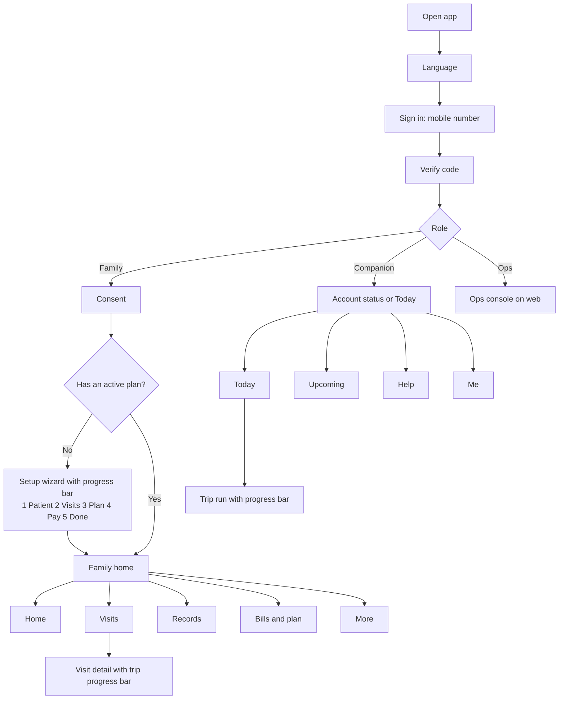

# App navigation and screen map: family, companion and ops

Date: 2026-11-12. Draft for founder review. Design only: no application code, no changes to any development branch, nothing built or deployed.
Companion documents: `AnugaCare_Payment_Screens_Design.md` (plan purchase and payment), `AnugaCare_Strategy_v2_Long_Term_Vision.md`.
Sources in the repository: `CLAUDE.md`, `docs/PRODUCT_SPEC.md`, `docs/design/tokens.md` (screen mapping, dated 2026-10-11), `supabase/migrations` (roles, access levels, trip states, consent purposes).
Labels: **EXISTS** = shown as implemented in `docs/design/tokens.md` (verify against the current app, which has moved on since); **SPEC** = in `PRODUCT_SPEC.md` but listed there as not built; **NEW** = my proposal, needs founder approval and probably an ADR (the repo rule: any decision that changes the product spec needs one).
Constraints from `docs/design/tokens.md` that this design respects: no fake ETA, map, countdown, notification count or verification badge; "no new capabilities are authorized by an image"; no separate patient mode; large tap targets (48 min, primary buttons 56), text at least 16 to 18, status never by colour alone, English, Telugu and Hindi.

---

## 1. Who sees what

The database already has three roles (`family`, `companion`, `ops_admin`) and four family access levels (`owner`, `editor`, `viewer`, `patient`).

| Person | App | What they can do | What they never see |
|---|---|---|---|
| **Owner** (family member who creates the profile and pays) | Family | Everything for their patients: schedule, visits, records, bills, consents, who else has access | n/a |
| **Editor** | Family | Book, reschedule, cancel visits; see status and notes | Billing and consent changes (owner only) |
| **Viewer** | Family | See visit status and timeline; read-only | Edit, pay, consent, vault unless granted |
| **Patient** | Family (the existing patient-access view, no separate mode) | Own schedule, pickup code, updates, own records | Billing, other patients |
| **Companion** | Companion | Today's and upcoming trips, trip essentials, step buttons, pickup code entry, notes, issue or no-show | **Vault, diagnoses, date of birth, billing** |
| **Ops admin** | Ops console (web) | Trips, schedules, exceptions, billing, assignments | Vault, unless the owner granted `ops_vault_access`; every view logged |

---

## 2. Navigation rules (apply to every screen)

1. **One primary action per screen,** a full-width button at least 56 high, placed at the bottom within thumb reach.
2. **Top bar:** back arrow on the left, screen title in the middle, language and help on the right. No hamburger menu.
3. **Top progress bar only on linear flows** (first-time setup, plan purchase, a visit in progress). It is a segmented bar under the top bar with the text "Step 3 of 5 · Choose plan". Colour is never the only signal.
4. **Bottom navigation** for the main areas only, 4 to 5 items, each with icon and label, never icon-only.
5. **Back keeps your work:** going back in a wizard keeps what was entered; "Save and finish later" is always available.
6. **Plain status words:** every status chip carries text ("On the way", "Waiting"), not just a colour.
7. **Errors and empty states are designed:** no blank screens; each says what happened and what to do next.
8. **Help is always one tap:** a "?" in the top bar opens a help sheet with the support number. No fake chat.
9. **Language switch** from the top bar on every screen; text can grow to 200% without clipping.
10. **Confirm only irreversible actions** (cancel a visit, report no-show) with a clear dialog.

---

## 3. The whole map



---

## 4. Family app

### 4.1 First-time setup wizard (top progress bar, 5 steps) `NEW`/`SPEC`
Patient setup, recurring setup and checkout are listed in `docs/design/tokens.md` as intentionally not built, so this whole wizard is new work.

| Step | Screen | Content | Primary button |
|---|---|---|---|
| 1 of 5 | **Who is the patient?** | First name, age band, relationship, language, mobility needs (checkboxes) | Continue |
| 2 of 5 | **Where and when?** | Home pin, centre, days and shift, emergency contact | Continue |
| 3 of 5 | **Choose a plan** | Trial, Care Plan, Safe Return cards (see payment design) | Choose this plan |
| 4 of 5 | **Review and pay** | Summary, refund terms, pay now or send link | Continue to payment |
| 5 of 5 | **All set** | What happens next, first visit date, "We confirm your named companion 48 hours before each trip" | Go to home |

Payment sub-screens (method, waiting, success, failed) belong to step 4 and are described in the payment design.
**Gate:** no live payment until you authorise it; the existing test adapter applies.

### 4.2 Bottom navigation: Home, Visits, Records, Bills, More

**Home** (`EXISTS`: home, patient picker, bookings; the rest `NEW`)
- Greeting and patient picker (EXISTS).
- **Next visit card** with a status chip and the trip progress bar (EXISTS data, new layout).
- Quick actions: "See pickup code" (EXISTS, only under current access and state rules), "Cancel visit" (EXISTS before the companion sets off), "Help".
- Updates preview (the inbox EXISTS).
- Plan card: "6 of 12 trips used" (NEW, needs plan data).

**Visits** (EXISTS: bookings, timeline)
- Tabs: Upcoming | Past.
- Each row: date, time, status chip.
- Tap opens **Visit detail** (4.3).
- "Edit pattern" (SPEC: reschedule, cancel pattern).

**Records** (EXISTS: list, photo upload, image viewer)
- List of documents and notes; "Add photo".
- If the vault consent is off: a banner "Turn on your private vault" that goes to Consent.
- Companions never see this area.

**Bills** (EXISTS: monthly invoices, detail, test payment)
- Segmented: Bills | Plan and receipts (NEW).
- Bills: issued, paid, overdue chips; detail; Pay (test adapter).
- Plan and receipts (NEW): current plan, trips left, receipts, refund requests.

**More** (mixed)
- Patients and access: patient picker (EXISTS); invite a family member with a role (SPEC, not built).
- Consents (EXISTS): trips, vault, support-vault access.
- Preferences (NEW, see open questions): language, preferred companion, notification choices.
- Help and support, Privacy notice, About, Sign out.

### 4.3 Visit detail with trip progress bar (`EXISTS` states)
The trip states come from the database: `scheduled → companion_en_route → picked_up → at_centre → handed_over → session_done → returning → dropped_home → completed`, plus `cancelled`, `no_show`, `issue_reported`.

Show nine steps in the family's words:

| State | Family sees |
|---|---|
| scheduled | Booked |
| companion_en_route | Companion on the way |
| picked_up | Picked up |
| at_centre | At the centre |
| handed_over | Handed to centre staff |
| session_done | Session finished |
| returning | On the way home |
| dropped_home | Home |
| completed | Visit complete |

Layout: top bar with date; **progress bar** under it ("Step 4 of 9 · At the centre"); status card; pickup-code card (only when allowed); timeline list; post-visit note after completion.
Banners for `cancelled`, `no_show`, `issue_reported` replace the bar with plain wording and a help button.
**Do not show** an ETA, a map pin or a fake countdown.

### 4.4 What each family access level sees

| Area | Owner | Editor | Viewer | Patient |
|---|---|---|---|---|
| Home | Full | Full | Status only | Own next visit |
| Visits | View, cancel, edit pattern | View, cancel, edit pattern | View only | Own visits |
| Records | Full, uploads | Per grant | Per grant | Own records |
| Bills and plan | Full, pay | Hidden | Hidden | Hidden |
| Consents | Full | Hidden | Hidden | Own view |
| Invite family | Yes (SPEC) | No | No | No |

---

## 5. Companion app

### 5.1 Entry
Sign in → verify → **account status** if not yet verified (EXISTS: `account_status_screen`) → Today.

### 5.2 Bottom navigation: Today, Upcoming, Help, Me
- **Today** (EXISTS): today's trips inside the allowed time window; each card shows time, patient first name, centre, status chip.
- **Upcoming** (EXISTS): future trips, no patient detail until inside the window.
- **Help** (NEW): support number, emergency guidance, "report a problem". The issue and no-show dialogs EXIST on the trip screen.
- **Me** (NEW): verification status, language, training status, sign out. Earnings summary is in the spec but listed as not built; do not add it without approval.

### 5.3 Trip run with top progress bar (`EXISTS` state actions)
The trip essentials screen shows only restricted fields (name, address, pickup time, emergency contact, mobility notes). The step buttons come from the state machine. "On my way" opens only from a configurable time before pickup (180 minutes provisional, founder decision F05).

Progress bar, 8 steps ("Step 3 of 8 · Pick up"):

| Step | Button | Rule |
|---|---|---|
| 1 | On my way | Disabled until the start window opens; shows when it opens |
| 2 | Picked up | **Requires the pickup code** from the family |
| 3 | At the centre | |
| 4 | Handed over | Handover to centre staff |
| 5 | Session finished | |
| 6 | Returning | |
| 7 | Dropped home | |
| 8 | Complete | **Requires a visit note** |

Always visible: "Report an issue" and "Patient not available" with confirmation dialogs and an emergency notice (EXISTS). One large primary button changes with the state.
**Never shown:** vault files, diagnoses, date of birth, billing, a map or phone-call action that is not already built.

---

## 6. Ops (web)

Existing sidebar: Trips, Schedules and assignment, Exceptions, Billing. Out of scope here. Later additions (not designed): plan sales and refunds, companion onboarding queue (SPEC), reliability metrics for centres (see the partnership strategy).

---

## 7. Screen inventory and build order

| # | Role | Screen | Status | Pilot need |
|---|---|---|---|---|
| 1 | All | Language, sign in, verify | EXISTS (PR #32 in review) | P0 |
| 2 | Family | Consent (trips, vault, support-vault) | EXISTS; mockup in progress | P0 |
| 3 | Family | Setup wizard 1 to 2: patient, visit pattern | SPEC, not built | **P0** (no way to create the first patient and schedule otherwise) |
| 4 | Family | Plan choice, review and pay, payment states | NEW | P0 (test mode) |
| 5 | Family | Home with next-visit card and progress bar | EXISTS data, new layout | P0 |
| 6 | Family | Visit detail with trip progress bar | EXISTS states | P0 |
| 7 | Family | Visits list, Records, Bills | EXISTS | P0 |
| 8 | Family | Plan and receipts | NEW | P0/P1 |
| 9 | Family | More, preferences, help | Mixed | P1 |
| 10 | Family | Invite family member with roles | SPEC | P1 |
| 11 | Companion | Account status, Today, Upcoming, trip essentials | EXISTS | P0 |
| 12 | Companion | Trip run with progress bar | EXISTS states, new layout | P0 |
| 13 | Companion | Help, Me | NEW | P1 |
| 14 | Family | Requests ("I need…"), medicines | SPEC, not built | Later |

---

## 8. Mockup prompts

**Master style block (paste at the start of every prompt).** Colours are taken from `docs/design/tokens.md`.
```
Mobile app UI mockup, single phone screen, full screen visible and not cropped, 390x844 portrait, flat vector UI, Material 3 inspired,
calm, trustworthy, elder-friendly: large tap targets (primary buttons 56px high), high-contrast text, generous spacing, rounded corners 12px.
Light theme: background #F7FBFA, white cards, mint soft surface #EAF7F4, selected #D4F0E9, primary teal #00666B with white button text,
ink #10243A, secondary text #465D6B, success green #166344 on #DDF4E8, warning amber #754900 on #FFF0CB.
(Dark theme variant: background #102426, cards #183235, mint buttons #8FE3D0 with dark teal text.)
Brand: "anugacare" lowercase wordmark with teal arch symbol and small marigold dot.
Font: Inter or Noto Sans; headings 22-28px bold; body 18px; status chips 14px bold with text, never colour alone.
Footer chip: "Development build · synthetic data only". No stock photos, no medical symbols, no map, no ETA, no fake counters. Text correctly spelled.
```

**F1 Family Home (active plan), light and dark**
```
[Master style block]
Screen: Family Home. Top bar: anugacare symbol left, language pill "English ▾" and a help "?" icon right.
Greeting "Good morning". Patient picker chip "Ravi Rao ▾".
Large "Next visit" card: "Tomorrow, 7:00 am", centre name "City Dialysis Centre", status chip "Booked".
Under it a segmented progress bar with text "Step 1 of 9 · Booked".
Three action buttons in a row (large, labelled): "See pickup code", "Cancel visit", "Help".
Card "Your plan": "Two-week Care Trial", "6 trips left".
Row "Updates" with two recent items.
Bottom navigation with five labelled items: Home (selected), Visits, Records, Bills, More.
```

**F2 Visit detail with trip progress bar**
```
[Master style block]
Screen: Visit detail. Top bar with back arrow and title "Wed, 12 Nov".
Segmented progress bar of 9 steps, text "Step 4 of 9 · At the centre".
Status card: "Handed to centre staff soon", companion first name "Suresh", chip "At the centre".
Card "Pickup code" showing "4 8 2 9 1 3" (six digits) in large digits with a note "Share this only with your companion."
Vertical timeline list: "Booked", "Companion on the way 6:20 am", "Picked up 6:45 am", "At the centre 7:25 am".
No map, no ETA. Secondary outline button "Help".
```

**F3 Setup wizard, step 3 of 5 (progress bar)**
```
[Master style block]
Screen: Setup. Top bar: back arrow, title "Choose a plan", "Save and finish later" text link on the right.
Under it a segmented progress bar with text "Step 3 of 5 · Choose a plan".
Three plan cards: "Two-week Care Trial ₹5,499, 6 round trips", "Care Plan ₹10,999 for 4 weeks, 12 trips", "Safe Return ₹7,799, 12 trips home".
Small text: "Fare is extra. Companions are not nurses."
Primary button: "Choose this plan".
```

**F4 Visits list**
```
[Master style block]
Screen: Visits. Top bar title "Visits". Segmented tabs "Upcoming" (selected) and "Past".
List of visit rows: date and time bold, centre name, status chip with text ("Booked", "Completed").
Floating-style secondary button at the bottom: "Edit schedule".
Bottom navigation: Home, Visits (selected), Records, Bills, More.
```

**F5 Records**
```
[Master style block]
Screen: Records. Top bar title "Records". Banner (information blue #185E83 on #E7F3FA): "Your records are private and not visible to your companion."
List of three document rows with a small document icon, title, date.
Primary button "Add photo". Bottom navigation with Records selected.
Variant B: vault off — a card "Turn on your private vault" with button "Review privacy choices".
```

**F6 Bills and plan**
```
[Master style block]
Screen: Bills. Top bar title "Bills". Segmented control "Bills" | "Plan and receipts" (selected).
Card: "Two-week Care Trial", "6 of 6 trips left", "Valid until 26 Nov".
List of receipts with amount, date and chip "Paid".
Link "Refund terms". Bottom navigation with Bills selected.
```

**F7 More**
```
[Master style block]
Screen: More. List rows with large icons and labels: "Patients and access", "Privacy choices", "Language", "Preferences", "Help and support", "Privacy notice", "About", and a red-outline "Sign out".
Bottom navigation with More selected.
```

**F8 Viewer variant of Home (limited access)**
```
[Master style block]
Same as Family Home but for a viewer: no "Cancel visit" button, no Bills item in the bottom navigation (Home, Visits, Updates, More), small banner "You can see updates. Only the account owner can make changes."
```

**C1 Companion Today**
```
[Master style block]
Screen: Companion Today. Top bar: anugacare symbol, language pill, help "?".
Title "Today". Trip cards: time "6:30 am", patient first name "Ravi", centre "City Dialysis Centre", chip "Starts in 2 h 10 m" or "Opens at 4:30 am" (text, not colour only).
Bottom navigation: Today (selected), Upcoming, Help, Me.
```

**C2 Companion trip run (outbound, pickup code)**
```
[Master style block]
Screen: Trip run. Top bar with back arrow and "Trip 1".
Segmented progress bar of 8 steps, text "Step 2 of 8 · Pick up".
Card "Essentials": first name, address, pickup time, emergency contact, mobility notes. No medical details, no map.
Field: "Pickup code" with four large digit boxes.
Large primary button "Picked up". Two secondary outline buttons: "Report an issue", "Patient not available".
Small emergency notice line at the bottom.
```

**C3 Companion trip complete (note required)**
```
[Master style block]
Screen: Complete visit. Progress bar "Step 8 of 8 · Complete".
Multiline field "Visit note (required)" with placeholder "How did the visit go?".
Primary button "Complete visit", disabled until a note is entered, with helper text "A note is needed to finish".
```

**C4 Companion Help and Me**
```
[Master style block]
Screen A "Help": large buttons "Call support", "Report a problem", text block "In an emergency, call 112".
Screen B "Me": verification status chip "Verified", language, training status, "Sign out".
```

Negative prompt: `photorealistic faces, stock photos, hospital crosses, stethoscope, nurse uniform, maps, ETA countdowns, notification badges, text artifacts, misspelled words, tiny buttons, low contrast, clutter, watermark, neon colours.`

---

## 9. Open questions
1. **"Likes":** I read it as preferences or favourites (language, preferred companion, notifications). If you meant something else, tell me. A "preferred companion" must not undermine the bypass controls in the pricing structure document.
2. **Patient view:** `PRODUCT_SPEC.md` describes a simplified patient view; `docs/design/tokens.md` says no new simplified mode. This design treats the patient as an access level inside the same app.
3. **Companion earnings summary** is in the spec but not built; add only with your approval.
4. **Plan data** (trips left, expiry) needs a data model. That is the ADR for the prepaid flow.
5. **Wizard order:** patient and visit setup before payment (my recommendation, so we do not take money before the centre and schedule are confirmed), or payment first.

## 10. Limits
- "EXISTS" comes from `docs/design/tokens.md` dated 2026-10-11 and the migrations. The app has changed since (PRs up to #32). A developer must verify each status.
- This is design only. No code, no branch changes, nothing built or run.
- Mockup prompts produce direction images; AI image tools garble text, so retype copy in Figma or Canva.
- Telugu and Hindi copy needs native review.


---

## 11. Addendum (2026-11-12): review of the companion mockups (boards 08 to 10, screens 29 to 40)

Correction first: the database issues a **6-digit** pickup code (`issue_pickup_otp`), not 4. The prompts above now say six.

### 11.1 Screen by screen

| Screen | Verdict | Why and what to change |
|---|---|---|
| 29 Companion profile setup ("Become a companion") | **Change** | A public self-sign-up conflicts with the curated, invite-only intake recommended for the pilot. Make it an invite-code or application form, not an open "Become a companion". Replace "Morning 6 to 12 / Evening 12 to 9" with availability by centre shift and days, because the scheduling analysis found the evening shift impractical |
| 30 Verification | **Keep, extend** | Shows ID, background check and training. Our funnel also has medical fitness, two paid shadow runs and a 20-trip probation. Show each as plain status text. Do not display "No issues found" for the background check; show "Complete" only (sensitive, lawyer to confirm). Status must come from the database, not a decorative badge |
| 31 Today | **Keep, adjust** | Remove the red notification dot unless it reflects a real count. Tabs: Today, Visits, Help, Profile now; add Earnings only when a payout model exists |
| 32 Trip essentials | **Change** | Keep pickup, drop, mobility needs and trip details. The emergency contact is in the spec, but show the name and a "Call via AnugaCare" action, not the raw number (see 11.2). "Get directions" is a map capability; defer. "Start journey" must stay disabled until the start window opens (existing rule) |
| 33 En route with map, ETA and calls | **Change** | Live map and ETA are not authorised (design contract: no map, no ETA). Keep the status, the "I have arrived" step and the address. Calls through a masked line only |
| 34 Pickup OTP (6 digits) | **Keep** | Matches the database. Add the remaining attempts message (5 attempts then lock) and a "Code not working? Contact support" link |
| 35 At the centre | **Change** | Remove the live map and "Arriving in 8 min". Keep "Report an issue". Add "Patient not available" |
| 36 Handover checklist | **Keep, strengthen** | Matches the verified-handover protocol. Auto-stamp the time; keep the staff name optional at first (staff may decline) but record it when given |
| 37 Return journey with map | **Change** | Remove the map and "Est. travel time 25 min". Show a pickup window, not a false-precision time |
| 38 Home arrival | **Keep** | Good completion checklist. Replace the call button with the masked action |
| 39 Post-visit note with fare and receipt | **Split** | The note is required and exists. **Fare entry and receipt photo are new** (the contract says not built). Defer until fares come from a controlled source, because companion-entered fares invite error and fraud |
| 40 Completed and earnings | **Defer** | Earnings are in the spec but not built, and sample amounts (₹250) do not match the pay model (₹430 effective per round trip, plus bonus). Build only after the payout model is decided |

### 11.2 Four conflicts to resolve

1. **Maps and ETA.** Screens 33, 35 and 37 show live maps and arrival times. The design contract forbids fake ETA and maps, and a live location feature needs its own consent, cost and ADR. Phase 2 at the earliest. A tap-to-open-in-maps link with the address is a simpler first step.
2. **Phone numbers and bypass.** Screens 32, 33 and 38 expose the family's number to the companion. That makes direct dealing easy, which the pricing and bypass analysis warns against. Use a masked relay or a coordinator line.
3. **Patient photos.** The mockups show avatar photos. The contract says no avatar photo. Use initials.
4. **Brand.** The boards say "Companion". The product is AnugaCare.

### 11.3 Two platform findings that matter for the build

1. **Arrival timestamps.** We promised centres reliability numbers (on-time drop, pickup wait). The current states give a drop time (`at_centre`) but **no "arrived for pickup" event**, so pickup wait cannot be measured. Adding one needs an ADR.
2. **One companion per trip.** The database assigns a single `companion_id` to a trip, covering both legs. The scheduling analysis found that the efficient design, a swap run (drop the next patient and collect the one who has just finished), needs **leg-level assignment**, which the current model does not support. Without it, a companion does one solo round trip a day, and a 15-family pilot needs about 9 part-time companions instead of 7. Decide whether the pilot starts solo (no change) or you fund the ADR for legs.

### 11.4 What I would give the colleague for these screens
- **Stream A scope for the companion app:** Today, Upcoming, trip essentials, trip run with the 8-step bar, pickup code, handover checklist, completion note.
- **Out of Stream A:** live maps and ETA, earnings, fare and receipt entry, public "Become a companion", masked calling (needs a provider decision and ADR), leg-level assignment.
- **Companion onboarding screens (29, 30)** come with the intake funnel, later, behind an invite.
