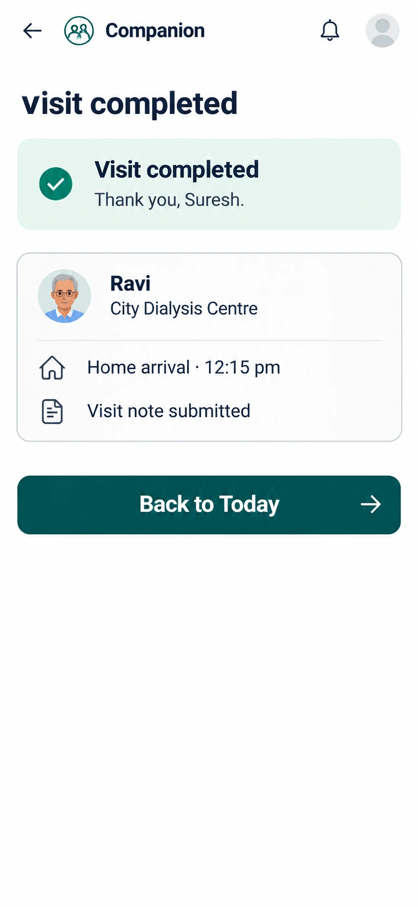

# C14 Visit completed (companion)

**Verdict: nearly there. Fix the header, the duplicate title and add a summary.** Status: CHANGE, P0.

## Each option: what it does

| Element | What it does | Data | Notes |
|---|---|---|---|
| Back arrow | Returns | none | After completion it should go to Today, not to the finished trip. |
| Logo and "Companion" | Label | none | Other screens use a plain "Companion" title. Make all companion headers the same. |
| Bell icon | Opens notifications | `my_notifications` | The contract bans a notification count. No count is shown, which is correct. Check it is needed for companions at all. |
| Grey avatar circle | Opens Me | profile | Show the companion's own avatar or initials. |
| Title "visit completed" | Heading | none | The first letter is lower case and the card repeats it. Remove one. |
| Green card "Visit completed, Thank you, Suresh" | Success message | none | Fine. |
| Patient card (photo, "Ravi", "City Dialysis Centre") | Display | `companion_my_trips()` | The photo is new personal data. See `_new_features`. |
| Home arrival 12:15 pm | Display the last time | `trip_events` | Add pickup and centre times as a short list. |
| Visit note submitted | Shows the note was saved | notes (required note rule exists) | Make it tappable to read the note. |
| Back to Today | Opens C3 | none | |

## Changes needed

1. One title, one success card.
2. Add a mini timeline (picked up, at centre, handed over, home).
3. Add "Next visit: ..." if there is one today.
4. Do not show earnings (deferred).
