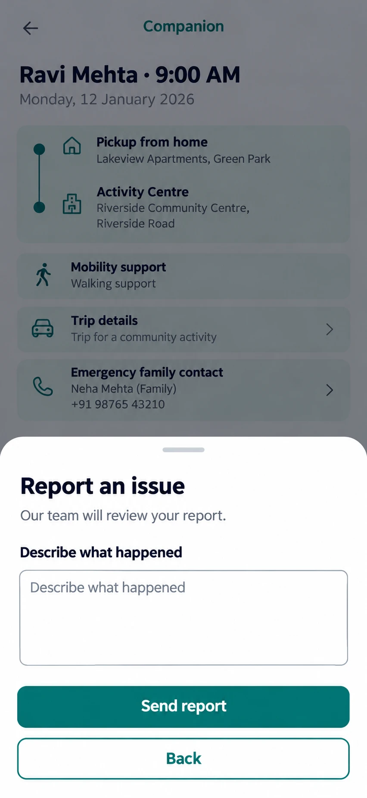

# C15 Report an issue (bottom sheet)

**Verdict: the sheet is fine, but it needs issue types, and the screen behind it has problems.** Status: KEEP (sheet) with CHANGE.

## Each option: what it does

| Element | What it does | Data / action | Notes |
|---|---|---|---|
| Handle bar | Drag to close | none | |
| "Describe what happened" box | Free text, required | text saved with the report | Label appears twice (heading and placeholder). Keep the label, change the placeholder to an example. |
| Send report | Sends the issue, sets the trip to `issue_reported`, notifies ops | existing issue state, `ops_exception_queue` | Show success ("We have your report") and what happens next. Do not promise a response time we cannot keep. |
| Back | Closes the sheet | none | Rename "Cancel" so it is not confused with the app's back. |

## Problems found in the screen behind the sheet

1. **A raw phone number is shown** (+91 98765 43210). The design contract and masked-contact plan say no raw numbers. Use a "Call through AnugaCare" button.
2. **"Activity Centre" and "Community activity"** are not dialysis. Fine for the later Outings line, wrong for the pilot. Use dialysis wording.
3. **The date, Monday 12 January 2026,** does not match the project timeline. Use sample dates close to 12 Nov 2026.
4. **Full name "Ravi Mehta".** Check what name fields `companion_my_trips()` returns. Companions may be allowed first name only.
5. Mobility support and trip details are good and should stay.

## Changes needed

1. Add issue-type chips: Patient not ready, Patient unwell, Cannot find family, Centre not ready, Other.
2. Add a red line: "In an emergency call 112" with a call button.
3. Add optional photo? Spec allows a photo only of a report or receipt, so no. Leave text only.
4. States: sending, sent, failed (keep the text so it is not lost).
