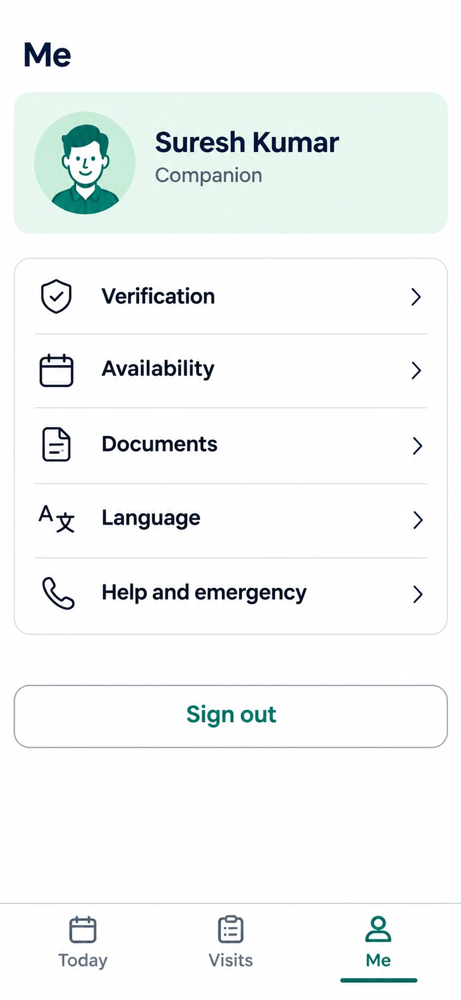

# C18 Me (companion profile)

**Verdict: good. Keep the layout, make 4 small fixes.** Status: CHANGE, P1.

## Each option: what it does

| Element | What it does when tapped | Data it needs | Notes |
|---|---|---|---|
| Profile card (avatar, "Suresh Kumar", "Companion") | Nothing, display only | `profiles`, `companions` | Show illustrated or initials avatar until the photo ADR is approved (see `_new_features`). Use the word "Companion", never nurse. |
| Verification | Opens a status page: ID check, training, any suspension, as plain words and dates | `companions` training/suspension fields (migration 20261022000100) | Row icon is a shield with a tick. The design contract bans a "verification badge", so use a neutral icon and put the status in words on the next page. |
| Availability | Opens C19 | availability data (new, needs ADR) | |
| Documents | Opens C20 (ID upload). Shows what is still needed | new storage, ADR | Only the verification team can open them. |
| Language | Chooses English, Telugu or Hindi, applied at once | ARB files | |
| Help and emergency | Opens C17: "In an emergency call 112", support call, short guides | static text and support number from `app_settings` | Also needs a one-tap link on every trip screen. |
| Sign out | Ends the session, returns to Welcome | auth | Ask for confirmation if a trip is in progress. |

## Changes needed

1. Add one line under "Verification" showing the state in words (e.g. "Complete" or "ID check pending").
2. Neutral icon for Verification (no badge look).
3. Bottom nav here is Today, Visits, Me. My map had Today, Upcoming, Help, Me. Pick one set and use it on every companion screen. Recommendation: Today, Visits, Me, with Help inside Me plus a help link on trip screens.
4. Add loading, error and signed-out-expired states.
