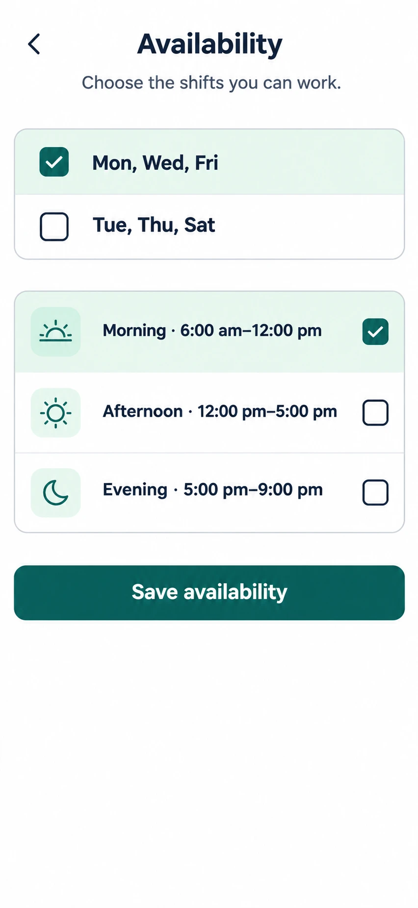

# C19 Availability (companion)

**Verdict: needs a redesign of the day and shift model.** Status: NEW, P1.

## Each option: what it does

| Element | What it does | Data | Notes |
|---|---|---|---|
| Day groups "Mon, Wed, Fri" and "Tue, Thu, Sat" | Picks days in two fixed bundles | new availability data | Too rigid, and Sunday is missing. Dialysis runs on Sundays. Replace with a per-day grid. |
| Morning, Afternoon, Evening checkboxes | Picks shifts | new availability data | Hours shown (6-12, 12-5, 5-9) do not match the scheduling analysis: shift 1 about 07:00, shift 2 about 11:30. Evening ends after 21:00 and is not offered in the pilot. |
| Save availability | Saves the choice | new RPC and table (ADR) | Show "Saved. Ops will confirm" because availability is a request, not a promise. |

## Changes needed

1. Per-day grid: rows Mon to Sun, columns Morning and Midday, tap to switch on.
2. Grey out Evening with "Not offered yet".
3. Use shift names that match what ops uses (read them from settings, not hard-coded).
4. Add "Days off / leave" later (not pilot).
5. States: empty (nothing chosen), saving, saved, failed.
6. Needs an ADR: no availability table exists yet.
