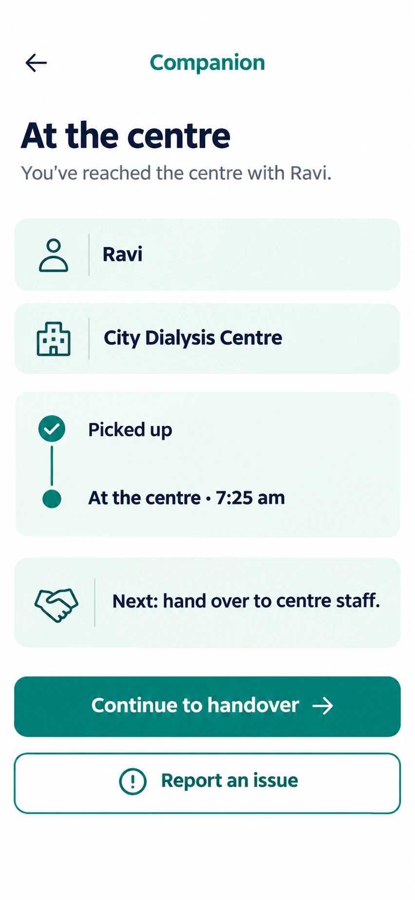

# C8 At the centre (companion)

**Verdict: good. Clear and calm. Needs the progress bar and two small additions.** Status: CHANGE, P0.

## Each option: what it does

| Element | What it does | Data / action | Notes |
|---|---|---|---|
| Back arrow | Returns to the trip run | none | Should not undo a state change. |
| Header "Companion" | Label only | none | Replace with the visit title for consistency (e.g. "Visit with Ravi"). |
| "Ravi" row | Display: patient first name | `companion_my_trips()` | Add the patient photo or initials avatar once the photo ADR is approved. |
| "City Dialysis Centre" row | Display centre name | `centres.name` | Add address and a "Navigate" button that opens the phone's maps app (no SDK, no data to us). |
| Timeline "Picked up", "At the centre 7:25 am" | Shows progress and times | `trip_events` | Add the time to "Picked up" too. |
| "Next: hand over to centre staff" | Tells the companion the next step | static text | |
| Continue to handover | Moves the trip to `at_centre` done and opens C9 checklist | `advance_trip` to the next state | Disable while the request is running. Show an error if it fails. |
| Report an issue | Opens C15 | issue report flow | |

## Changes needed

1. Add the 8-step progress bar at the top (step 4 highlighted).
2. Add "Navigate" and the centre address.
3. Add the time to "Picked up".
4. Add a one-tap emergency/help link.
5. Add states: saving, failed (retry), offline.
